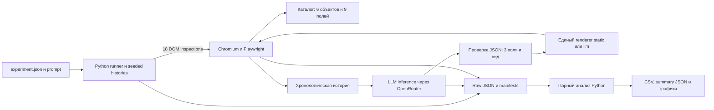

# Проект неявной адаптации веб-каталога

Практическая работа № 3. Курс «Проектирование и развертывание веб-решений в экосистеме Python». Тема ВКР: «Исследование эффективности методов адаптации веб-интерфейсов под поведение их пользователей».

LLM по истории просмотра недвижимости выбирает три поля карточки и вид cards/comparison. Эксперимент сравнит покрытие скрытых потребностей с фиксированными полями price/area/rooms. Одинаковый браузерный сценарий проверит доступ к значениям. Это исследование механизма адаптации на синтетических историях; человеческое удобство потребует отдельной проверки.

## 1. Литература

Выбраны шесть первичных работ с полным текстом: четыре за 2024–2026 годы, пять рецензируемых CHI/IUI и один препринт. Экспериментальные оценки есть в Todi, Gajos, Jelly, DynaVis и Generative UI; контролируемые пользовательские сравнения в Todi, Gajos и DynaVis. ReLAY содержит исследовательский probe без static-контроля.

Таблица сохраняет 12 полей для каждой работы. Шкала воспроизводимости: 0, недостаточное описание; 1, описанный метод; 2, частичные материалы; 3, официальный исполняемый артефакт с входами, инструкциями и закреплённой версией. Оценка доступности не означает выполненного повторения; «не указано» относится к проверенным материалам.

| Работа: поля 1–2 | Система и факторы: 3–4 | Измерения и контроль: 5–6 | Среда и процедура: 7–8 | Анализ и ограничения: 9–10 | Артефакты и воспроизводимость: 11–12 |
|---|---|---|---|---|---|
| **1.** Todi K., Bailly G., Leiva L. A., Oulasvirta A. *Adapting User Interfaces with Model-based Reinforcement Learning*. CHI 2021, art. 573, 13 pp. [DOI](https://doi.org/10.1145/3411764.3445497), [текст](https://userinterfaces.aalto.fi/adaptive/resources/chi2021-todi-adaptive.pdf). **2.** Может ли планирование улучшить адаптацию и время выбора относительно static/frequency? Формальные H0/H1 не указаны. | **3.** MCTS, предсказательные HCI-модели, value network; перестановки и группировки меню, без LLM. **4.** Пользовательское сравнение Static/Frequency/MCTS; технически 5/10/15 пунктов × 8 историй × 4 раскладки, горизонты 4/6/8/10. | **5.** Время выбора, мс; ошибки, шт.; предсказанное улучшение, %; время вычисления, с. **6.** 15 пунктов в user study, Zipf 1.5, одинаковое распределение внутри участника, непересекающиеся названия, адаптация между блоками, обязательный правильный ответ. | **7.** Python 3.7, TensorFlow 2.0.0, GNU/Linux Xeon Gold 2.10 GHz; user study на 15″ MacBook Pro Retina с Magic Mouse и HTML/JS. Версии браузера/ОС не указаны. **8.** 18 участников; внутри участников, латинский квадрат 3×3; 3 условия × 3 блока × 2 меню × 20 выборов, всего 6480 trials; паузы 3 с/1 мин/5 мин на разных уровнях. Отдельный исключаемый прогрев не указан. | **9.** Mixed-effects RM ANOVA, F(2,17)=5.47, p<.05; Tukey HSD: MCTS 2162 мс, Static 2283, Frequency 2298. Успех симуляции 92.7%/89.6% нельзя приписывать людям. **10.** Узкая лабораторная задача, стационарный синтетический спрос, зависимость симуляции от HCI-модели; нет LLM или полей карточек. | **11.** [Официальный код и входы](https://github.com/aalto-ui/chi21adaptive/tree/83d75f0c9dee7002e1d38f21108fef52d7be1b85), MIT, инструкции `python3 plan.py`, версия закреплена commit. Human raw data и полный lock не подтверждены. **12.** 3/3 для технического артефакта, без заявления о повторении пользовательского эффекта. |
| **1.** Gajos K. Z., Everitt K., Tan D. S., Czerwinski M., Weld D. S. *Predictability and Accuracy in Adaptive User Interfaces*. CHI 2008, pp. 1271–1274. [DOI](https://doi.org/10.1145/1357054.1357252), [текст](https://www.eecs.harvard.edu/~kgajos/papers/2008/kgajos-chi08-predictability.pdf). **2.** Улучшают ли точность и предсказуемость выполнение, использование панели и удовлетворённость? | **3.** Word-подобный интерфейс, восемь адаптивных копий при сохранении исходных команд; без ML/LLM. **4.** Внутри участников 2×2: точность 50/70% и MRU/случайный порядок. | **5.** Время задания и выбора, с; использование панели, %; Likert 1–7; восприятие точности, %; gaze transitions, %. **6.** Заранее заданные последовательности и состав панелей, максимум одна замена за действие, восемь кнопок, расстояние до исходных команд >20° поля зрения. | **7.** Pentium 4 2.8 GHz, 2 GB, LCD 18″, мышь; модель eye tracker не указана. **8.** 23 участника; практика без адаптации, четыре сбалансированных набора по 60 выборов, первые десять исключены; менее часа. Gaze-анализ: 22 набора у 16 участников. | **9.** RM ANOVA для времени после логарифмирования, ordinal logistic regression, Bonferroni .05/8. При точности 50/70% среднее время задания 197/177 с, использование 70.6/86.4%; значимого выигрыша времени от предсказуемости не обнаружено. **10.** Искусственные цели и точность, случайность как крайнее приближение непрозрачной адаптации, малая gaze-подвыборка, пропуски. | **11.** Текст и [авторская запись](https://www.eecs.harvard.edu/~kgajos/papers/2008/gajos08predictability.shtml); проверенные код, raw data и закреплённая среда не указаны. **12.** 1/3: можно реконструировать метод, точный запуск авторской версии не обеспечен. |
| **1.** Kim E., Chowdhury S. S., Song H., Suh B. *In-Situ Adaptive Interfaces for Online Browsing: Design Dimensions for Intent-Responsive Automation and User Control*. IUI 2026, pp. 174–196. [DOI](https://doi.org/10.1145/3742413.3789092), [текст](https://gracekim.me/docs/AdaptiveInterfaces.pdf), [peer-review record](https://snu.elsevierpure.com/en/publications/in-situ-adaptive-interfaces-for-online-browsing-design-dimensions/). **2.** Как принимаются изменения, воспринимаются усилия и выбирается контроль? Количественных H0/H1 нет. | **3.** ReLAY: Chrome extension, React/JS, FastAPI, gpt-4o-2024-08-06 и gpt-4.1-2025-04-14; LLM классифицирует намерение по clicks/search/navigation/dwell/scroll и DOM. **4.** Детализация Agoda, иерархия Yelp, порядок Amazon, затем совместное условие 29cm; diversive/specific, без рандомизации намерения. | **5.** Принятие/отмена, шт. и %; задержка override, с; NASA-TLX и Likert 1–7, SUS, интервью. **6.** Обучение, отмена/отключение адаптации; static отсутствует, способ адаптации смешан с сайтом. | **7.** Удалённый Chrome/Zoom на ноутбуках участников либо подготовленном ноутбуке; hardware, версии ОС/Chrome, sampling и API latency не указаны. **8.** 10 участников 21–32 лет, около 90 мин: tutorial 20, три задачи по 10, совместное условие 20, интервью 20; первые три условия рандомизированы, незнакомый сайт изучают ещё 2 мин. | **9.** Качественный и описательный анализ: 312/362 изменений не отменены, 50 отменены; CI и теста причинного эффекта нет. События не образуют n=362 независимых участников. **10.** Малый probe без baseline, нет независимой точности intent; acceptance не доказывает пользу. Preset DOM, нет mobile/Shadow DOM; шкала SUS в приложении описана неоднозначно. | **11.** Prompts, UI, анкеты и timeline в приложениях PDF; исполняемый репозиторий, события и закреплённая среда не подтверждены. **12.** 1/3: доступны метод и prompts, полного пакета повторения нет. |
| **1.** Cao Y., Jiang P., Xia H. *Generative and Malleable User Interfaces with Generative and Evolving Task-Driven Data Model*. CHI 2025, 20 pp. [DOI](https://doi.org/10.1145/3706598.3713285), [текст](https://hci.ucsd.edu/papers/jelly.pdf). **2.** Полезны ли представление и изменение информации; где возникают ошибки? Формальных направленных гипотез нет. | **3.** Jelly строит object-relational schema, зависимости и React UI по явному запросу. **4.** Технически 25 сценариев × 2 подробности запроса; user study: один инструмент, две свободные задачи, без static-контроля. | **5.** Категории релевантности сущностей/атрибутов; корректность зависимостей, %; Likert 1–5, изменения и ошибки. **6.** Парные менее/более подробные запросы; контрольного инструмента в user study нет. | **7.** Python backend, Claude 3.5 Sonnet/GPT-4o, JSON, few-shot и проверки совместимости; точные snapshots/железо не подтверждены. **8.** Технически 197 сущностей, 1052 атрибута, 232 зависимости; два кодировщика, третий разрешает разногласия. 8 участников 21–28 лет, около 80 мин, tutorial и две задачи по 20 мин с follow-up. | **9.** Описательные доли: необходимые/ожидаемые атрибуты 93.91/95.17%; корректные связи 91.5%, механизмы 96.9%; три ошибки на 120 follow-up. Тестов, CI и коэффициента согласия нет. **10.** Однородная малая выборка, нет baseline, свободные задачи, помощь, самоотчёты; сценарии созданы GPT-4o, техническая оценка прежде всего data model. | **11.** [Оценённые модели](https://jelly-modeleval.netlify.app/), описание supplements; runnable code и закреплённые API snapshots не подтверждены. **12.** 2/3: частичные outputs и метод позволяют приблизительно повторить оценку, точная регенерация не обеспечена. |
| **1.** Vaithilingam P., Glassman E. L., Inala J. P., Wang C. *DynaVis: Dynamically Synthesized UI Widgets for Visualization Editing*. CHI 2024, 17 pp. [DOI](https://doi.org/10.1145/3613904.3642639), [текст](https://glassmanlab.seas.harvard.edu/papers/dynavis.pdf). **2.** Снижают ли генерируемые widgets усилия редактирования и когда их предпочитают? Формальные H не выделены. | **3.** Явная NL-команда меняет визуализацию и создаёт постоянный widget. **4.** Внутри участников UIDW/UINL; stocks/unemployment/weather, пять подзадач; порядок инструментов и задач сбалансирован случайным назначением. | **5.** Успех, время, мин:с; команды и действия, шт.; Likert, NASA-TLX, предпочтение, ошибки/задержки. **6.** UINL уже имеет NL и готовые widgets; UIDW добавляет генерацию; чистого widget-only baseline нет. | **7.** React/TypeScript, Flask, pandas/LIDA, Vega-Lite v5, GPT-3.5-turbo, AST/compile/repair; точный snapshot модели и железо не указаны. **8.** 24 участника без опыта Vega; по набору задач в каждом условии, восемь наблюдений на task×condition; tutorial и 5 мин практики, лимит 15 мин на задачу, think-aloud и интервью. | **9.** Парные t-тесты: ease 6.26/5.13, p=.004; понимание намерения 6.04/4.95, p=.024; NL-команды 2.67/8.4, p<.001. Время 6:36/7:22 различается незначимо; 23/24 предпочли DynaVis. **10.** Короткая лабораторная работа, разные задачи у человека, ошибки дат, расхождение прямого сравнения TLX с отдельными оценками, нет долгого использования. | **11.** Полный текст; проверенный SUT-репозиторий/raw data не подтверждены, одноимённый training-dynamics проект не относится к работе. **12.** 1/3: подробный метод без подтверждённого исполняемого пакета. |
| **1.** Leviathan Y. et al. *Generative UI: LLMs are Effective UI Generators*. arXiv:2604.09577v1, 2026, 23 pp., препринт. [Запись](https://arxiv.org/abs/2604.09577), [текст](https://arxiv.org/pdf/2604.09577v1). **2.** Предпочитают ли оценщики страницу обычному выводу LLM; как влияют модель и prompt? Формальные H не выделены. | **3.** Gemini генерирует HTML/JS и assets для явного запроса. **4.** Expert website/generated UI/Markdown/search/plain text; абляции пяти семейств моделей и full/minimal/no-philosophy prompting. | **5.** Парные Left/Neutral/Right preferences, Elo, ошибки; человеческое время выполнения задачи не измеряется. **6.** Одинаковые запросы и cached outputs; генерация исключена из сравнения; рандомизация сторон и точные snapshots не раскрыты. | **7.** Gemini, tool server с поиском/изображениями, system instructions, post-processors; среда генерации не закреплена. **8.** 100 LMArena queries, восемь исключены, ещё 100 вручную выбранных запросов; два оценщика на результат, общее n уникальных оценщиков не указано. PAGEN: 18 из 34 приглашённых contractors, по 5–20 страниц, 3–5 ч на страницу, AI разрешён. | **9.** Доли и Elo: generated UI vs Markdown 82.8% побед; против экспертов 35.3%, эксперты 50%, остальные ties. CI, названные тесты и поправка не приведены. **10.** Время генерации 1–2 мин исключено, эстетика смешана с содержанием, отбор запросов, неполное описание оценщиков, AI у expert baseline; hidden intent не проверяется. | **11.** [PAGEN pages/code](https://github.com/GenerativeUI/GenerativeUI.github.io/tree/main/static/pagen), [демо](https://generativeui.github.io/); полный server/model package не доступен в проверенных материалах. **12.** 2/3: страницы и запросы доступны, точная генерация и rating study недоопределены. |

Todi связывает проект с НИР1: история взаимодействий, static-контроль и разделение симуляции/наблюдений. ReLAY обосновывает неявный LLM-вывод по обычным действиям, но принятие изменений не заменяет точность намерения. Из Gajos переносится различие точности и представления. Меню не становятся задачей нашего стенда. Jelly предлагает промежуточную модель, DynaVis проверяет генерацию отдельно от исполнения, Generative UI показывает необходимость учитывать задержку. Последние три системы инициируются явным запросом и не доказывают качество неявной адаптации (ссылки на первичные тексты в таблице).

## 2. Гипотезы

**RQ:** повышает ли LLM по истории просмотра покрытие актуальных скрытых потребностей относительно static, включая смену интереса? Основной исход C = |selected_fields ∩ required_fields|/3; парная разность D = C_llm − C_static. Для каждого сценария **H0: E(D)≤0.20; H1: E(D)>0.20**. Порог 20 процентных пунктов выбран автором до измерений как инженерный критерий. Поддержка практического эффекта: нижняя граница отдельного 95%-го парного bootstrap-интервала >0.20.

Факторы: static/llm и focused/shift. Static показывает price/area/rooms и cards, LLM выбирает ровно три из девяти полей и cards/comparison. Каталог содержит шесть квартир. Вторичные исходы: точность вида; реальные DOM-клики для извлечения трёх полей трёх квартир; browser_ms после применения схемы; отдельно API latency, tokens, сообщённый cost и ошибки. Время API и сбор истории исключены из browser_ms. Отсутствующий cost парсер заменяет нулём, что не доказывает бесплатность.

История содержит 18 DOM-осмотров. Dwell 2500–7000 мс задаётся программно без реального ожидания. Генератор выбирает одну из шести троек: commute/metro/parking; school/park/rooms; price/fees/area; area/rooms/park; price/commute/fees; metro/school/park. В focused интерес постоянен, в shift первые шесть событий относятся к прежнему, последние двенадцать к актуальному. На индексах 4 и 13 вставляется постороннее поле. Comparison задаётся возвратами к p0/p1/p2, cards последовательным просмотром шести квартир.

Модель получает только события: объект, поле, временную отметку и dwell. Метки required_fields/required_view и сценарий остаются вне request. Prompt объясняет словарь полей и связь поведения с представлением. Веса модели не обучаются. Профили известны разработчику; независимого закрытого тестового набора нет.

Объективность: метки заданы независимо от ответа, клики зарегистрированы DOM, девять значений сверяются с каталогом. Контролируемость: одинаковые плановые истории, renderer, viewport 1280×900, DEFAULT перед сбором и новый контекст браузера. Повторяемость: второй свежий запуск в той же среде. Воспроизводимость анализа: расчёт из сохранённых ответов; исполнения: перенос кода, образа, lockfile и входов. Реплицируемость потребует независимой реализации или новых человеческих историй. Фальсифицируемость обеспечивают заранее заданные D и порог; ошибки и недостаточный эффект не исключаются.

## 3. Стенд



Схема хранится в [architecture.mmd](architecture.mmd). Реализация: [adaptation.py](../adaptive-ui-stand/web/adaptation.py), [experiment.py](../adaptive-ui-stand/runner/experiment.py), [analysis.py](../adaptive-ui-stand/runner/analysis.py).

| Компонент | Версия и назначение |
|---|---|
| Каталог HTML/JS, Python HTTP server | Git SHA и source hashes; единый renderer отделяет схему от отображения по мотивам Jelly. |
| Playwright/Chromium | Playwright 1.56.0, версия Chromium в manifest; реальные клики и проверка значений по мотивам разделения наблюдений/предсказаний Todi. |
| OpenRouter LLM | nvidia/nemotron-3.5-lightning:free; temperature 0, seed 4210, max_tokens 700, reasoning disabled, timeout 90 с, без retry. Контекстное распознавание по мотивам ReLAY; ID не закрепляет веса провайдера. |
| Анализ Python | NumPy 2.2.6, SciPy 1.15.3, Matplotlib 3.10.3; полный [lockfile](../adaptive-ui-stand/runner/requirements.lock), pip 25.3. Версия интерпретатора проверяется `python --version`. |
| Docker Compose | [Dockerfile](../adaptive-ui-stand/Dockerfile): Playwright v1.56.0-noble, digest sha256:a7f6cf3ae520c9d670ad956572c13747ed5abdbba5123a01526f873ed1662528. Версии Docker/Compose фиксируются на хосте. |

Площадка: Apple M2, 8 GiB, macOS 26.5.1; Docker VM 8 CPU/3.83 GiB. По [compose.yaml](../adaptive-ui-stand/compose.yaml) web получает 1 CPU/256 MiB, runner 2 CPU/2 GiB, shared memory 1 GiB. Runner использует внутренний HTTP, web публикуется на loopback 8040. Нужен внешний HTTPS OpenRouter; сборка обращается к registry/Python index. Ключ передаётся окружением OPENROUTER_API_KEY и не сохраняется в request.

При API/JSON/schema error сохраняются причина, response и DEFAULT с valid=false. Этот исход входит в анализ. Валидная схема содержит только fields/view, три различных разрешённых ID и допустимый вид; сама валидность не доказывает правильность выбора.

## 4. Проверки

Команды выполняются из `adaptive-ui-stand`. Это ожидаемые условия будущего запуска; подробности полного цикла находятся в [scripts/run.py](../adaptive-ui-stand/scripts/run.py).

| Уровень | Команда или действие | Ожидаемый результат и допуск |
|---|---|---|
| 1. Код | `git rev-parse HEAD`, `git status --porcelain` | SHA/dirty соответствуют manifest; source_sha256 совпадает для web/runner/configs. Изменённая копия архивируется целиком. |
| 2. Зависимости | `docker compose run --rm --no-deps runner pip check`, затем `pip freeze` той же командой | No broken requirements found; версии совпадают с lock, допуск 0. |
| 3. Образ | `docker image inspect adaptive-ui-stand:local` | ID сохранён; base digest закреплён. При другом index сравниваются platform manifest/config, включая build records. |
| 4. Данные | `make experiment`; проверить raw/manifests | 50 записей, 40 main/10 A/A; 18 событий, одинаковая последовательность полей/объектов и синтетический dwell; часовые отметки разные. Меток в request нет, SHA raw совпадает; потерь 0. |
| 5. Конфигурация | `shasum -a 256 configs/experiment.json`, проверить snapshots | config/prompt/protocol сохранены, хеши совпадают. Canonical digest config рассчитывается adaptation.digest, отличается от SHA байтов; допуск содержания 0. |
| 6. Случайность | Повторить `make experiment` | Seeds 4210–4219, планы и порядок совпадают. Static coverage/view/clicks точны; различия LLM и часов публикуются. |
| 7. Полный цикл | `docker compose config`, `make experiment` | Exit 0; калибровки true: известный путь 3 клика, cold DEFAULT 0, неверная схема отвергнута, девять значений верны. |
| 8. Метаданные | Проверить environment/summary/raw | 20 LLM-попыток, 10 пар/scenario; при доступном API 20 сохранённых HTTP-ответов. Browser errors/wrong values 0; сбои API сохранены. CPU относительно 2 cores, время без выдуманного ±5%. |
| 9. Анализ/перенос | `make analyze RUN=<каталог>`; повторить на другом хосте | Те же raw дают coverage/CI/p с допуском 1e−12; dz=null допустим. Static-пути совпадают, миллисекунды сравниваются описательно. CI pipeline здесь не реализуется. |

```text
adaptive-ui-design/
  REPORT.md
  README.md
  architecture.mmd
  configs/
    experiment.json
    protocol.md
adaptive-ui-stand/
  Dockerfile
  compose.yaml
  Makefile
  configs/experiment.json
  web/{index.html,server.py,adaptation.py}
  runner/{experiment.py,analysis.py,reanalyze.py,requirements.lock}
  scripts/run.py
  results/implicit-<UTC>/
    config.json
    prompt.txt
    environment.json
    calibration.json
    raw/*.json
    manifests/*.json
    per-run.csv
    summary.json
    figures/
  results/latest.json
  results/processed/
```

Каждый полный запуск сохраняется отдельно. Raw содержит историю, метки, request/response, схему, исходы и ошибки. Manifest хранит Git, source hashes, среду, порядок и SHA raw. Указатели latest/processed не заменяют архив. Полная структура и команды поставляются с реализацией задания 4.

## 5. План

Один запуск: 2 стратегии × 2 сценария × 10 seeds = 40 основных прогонов, из них 20 LLM. Дополнительно пять static A/A-пар используют focused seeds 4210–4214, всего 50 контекстов. Второй полный свежий запуск делает ещё 20 inference-попыток; серии анализируются отдельно, без увеличения n до 20. Порядок перемешан seed 4210 и повторяется между сериями; выполнение последовательное.

Перед основными прогонами отдельная страница выполняет smoke, путь на три клика и cold DEFAULT на ноль. Прогрев исключён из эффекта. Генерация 10000 историй проверяет стоимость генератора. Средний cgroup CPU runner/Chromium за прогон включает ожидание API, поэтому headroom не исключает кратких пиков. A/A ожидает нулевые разности coverage/кликов; пять пар и p>.05 не доказывают эквивалентность времени.

Runner извлекает три поля у p0/p1/p2. Если нужно сравнение, а выбраны карточки, открывает таблицу; обратного переключения не требует. Недостающий столбец comparison раскрывается сразу для трёх квартир, в cards каждое поле отдельно. Клики зависят от этого объявленного рецепта.

Анализ использует n=10 пар на сценарий, 5000 percentile-bootstrap перевыборок со seed 4210. Exact two-sided sign-flip перебирает 2^10 комбинаций знаков при их обменности; Holm корректирует два p при α=.05. Это проверка нулевого эффекта, отдельно от практического порога. Публикуются разности, CI, p/Holm и dz либо null при нулевой дисперсии. Отдельные CI не являются одновременными. Coverage показывается точками/boxplot, browser/API время отдельными ECDF; Spearman порядка с временем носит разведочный характер.

API-сбои остаются в основной оценке с DEFAULT. При неполной парности, browser errors или неверных значениях вывод откладывается, пакет сохраняется и после исправления выполняется новый полный запуск. Кешированные ответы пригодны для анализа, но не заменяют свежее повторение API.

## 6. Ограничения

| Валидность | Угроза, контроль и граница |
|---|---|
| Внутренняя | Парные планы, новые контексты и метки вне request устраняют основные смешения; временные отметки, API и нагрузка хоста меняются, порядок серий одинаков. |
| Конструктная | Покрытие измеряет совпадение с генератором, DOM-клики фиксированный рецепт; синтетический dwell и миллисекунды не измеряют человеческое намерение, доверие или UX. |
| Внешняя | Один каталог, шесть ясных профилей, одна модель, нет закрытого test split; нужны новые истории и участники. |
| Статистических выводов | Анализ по истории, парный CI, Holm и раздельные серии предотвращают псевдорепликацию; малый дискретный n и обменность знаков ограничивают вывод. |

При выполнении критерия вывод относится к LLM против фиксированных полей в соответствующем сценарии. Эвристического baseline нет, поэтому превосходство над простыми правилами не устанавливается. Следующий этап должен проверить новые истории и лишь затем действия участников.
