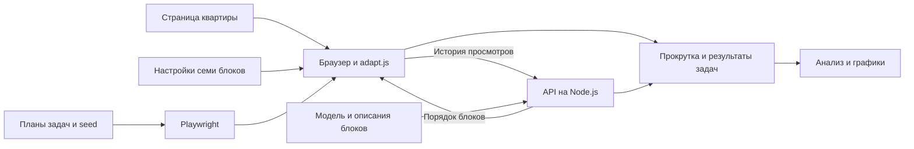

# Проект неявной адаптации веб-каталога

Практическая работа № 3. Курс «Проектирование и развертывание веб-решений в экосистеме Python».
Тема ВКР: «Исследование эффективности методов адаптации веб-интерфейсов под поведение их пользователей».

Планируется проверить семантическую адаптацию страницы отдельной квартиры. Внешний JavaScript-скрипт будет поднимать подходящие блоки выше по странице. Выбор делает отдельный бэкенд на Node.js по истории просмотров. Для сравнения используется та же страница с исходным порядком блоков.

## 1. Литература

Для обзора выбрал шесть работ. Четыре опубликованы в 2024–2026 годах, пять прошли рецензирование на CHI или IUI, одна доступна как препринт. В работах Todi, Gajos, Jelly, DynaVis и Generative UI проводились эксперименты; в первых двух и DynaVis участники сравнивали разные варианты интерфейса. В ReLAY изучались действия и впечатления пользователей, но сравнения с фиксированным интерфейсом не было.

Шкала воспроизводимости: 0 (нельзя повторить даже идею), 1 (методика без артефактов), 2 (код или данные без закреплённого окружения), 3 (артефакт с закреплённым окружением).

### Источники

**Todi, 2021.** Todi K., Bailly G., Leiva L. A., Oulasvirta A. *Adapting User Interfaces with Model-based Reinforcement Learning*. CHI 2021, art. 573, 13 pp. [DOI](https://doi.org/10.1145/3411764.3445497), [текст](https://userinterfaces.aalto.fi/adaptive/resources/chi2021-todi-adaptive.pdf).

**Gajos, 2008.** Gajos K. Z., Everitt K., Tan D. S., Czerwinski M., Weld D. S. *Predictability and Accuracy in Adaptive User Interfaces*. CHI 2008, pp. 1271–1274. [DOI](https://doi.org/10.1145/1357054.1357252), [текст](https://www.eecs.harvard.edu/~kgajos/papers/2008/kgajos-chi08-predictability.pdf).

**ReLAY, 2026.** Kim E., Chowdhury S. S., Song H., Suh B. *In-Situ Adaptive Interfaces for Online Browsing: Design Dimensions for Intent-Responsive Automation and User Control*. IUI 2026, pp. 174–196. [DOI](https://doi.org/10.1145/3742413.3789092), [текст](https://gracekim.me/docs/AdaptiveInterfaces.pdf), [сведения о рецензировании](https://snu.elsevierpure.com/en/publications/in-situ-adaptive-interfaces-for-online-browsing-design-dimensions/).

**Jelly, 2025.** Cao Y., Jiang P., Xia H. *Generative and Malleable User Interfaces with Generative and Evolving Task-Driven Data Model*. CHI 2025, 20 pp. [DOI](https://doi.org/10.1145/3706598.3713285), [текст](https://hci.ucsd.edu/papers/jelly.pdf).

**DynaVis, 2024.** Vaithilingam P., Glassman E. L., Inala J. P., Wang C. *DynaVis: Dynamically Synthesized UI Widgets for Visualization Editing*. CHI 2024, 17 pp. [DOI](https://doi.org/10.1145/3613904.3642639), [текст](https://glassmanlab.seas.harvard.edu/papers/dynavis.pdf).

**Generative UI, 2026.** Leviathan Y. et al. *Generative UI: LLMs are Effective UI Generators*. arXiv:2604.09577v1, 2026, 23 pp., препринт. [Запись](https://arxiv.org/abs/2604.09577), [текст](https://arxiv.org/pdf/2604.09577v1).

### Что исследовали

| Работа | Вопрос | Система | Что сравнивали авторы |
|---|---|---|---|
| Todi, 2021 | Может ли планирование улучшить адаптацию и время выбора относительно фиксированного интерфейса и адаптации по частоте использования? Формальные H0/H1 не указаны. | Поиск по дереву методом Монте-Карло (MCTS), модели взаимодействия человека с компьютером и нейросеть оценки вариантов; перестановки и группировки меню, без языковой модели. | С участниками сравнивали три варианта: фиксированное меню, выбор команд по частоте использования и метод MCTS. Отдельно в симуляции меняли число пунктов меню (5, 10 или 15), использовали 8 историй обращений и 4 раскладки. Алгоритм оценивал последствия изменений на 4, 6, 8 или 10 шагов вперёд. |
| Gajos, 2008 | Улучшают ли точность и предсказуемость выполнение, использование панели и удовлетворённость? | Word-подобный интерфейс, восемь адаптивных копий команд при сохранении исходных команд; без машинного обучения и языковых моделей. | Каждый участник работал с четырьмя вариантами панели: последние использованные команды при точности 50%; последние использованные команды при точности 70%; случайный набор при точности 50%; случайный набор при точности 70%. Точность здесь означает долю заданий, в которых нужная кнопка уже есть на панели. |
| ReLAY, 2026 | Как принимаются изменения, воспринимаются усилия и выбирается контроль? Количественных H0/H1 нет. | ReLAY: расширение Chrome, React/JS, FastAPI, gpt-4o-2024-08-06 и gpt-4.1-2025-04-14; большая языковая модель (LLM) определяет намерение по нажатиям, поиску, переходам, длительности просмотра, прокрутке и структуре страницы (DOM). | На Agoda меняли количество видимых подробностей, на Yelp порядок разделов, на Amazon порядок элементов с учётом истории просмотра. На четвёртом сайте, 29cm, изменения проверяли вместе. Участники свободно изучали сайты или искали с определённой целью; намерение не назначалось случайно. |
| Jelly, 2025 | Полезны ли представление и изменение информации; где возникают ошибки? Формальных направленных гипотез нет. | Jelly строит объектно-реляционную схему данных, зависимости и интерфейс на React по явному запросу. | Для 25 сценариев сравнивали результаты менее и более подробного запроса. Участники выполняли по две свободные задачи в Jelly; другого инструмента для сравнения не было. |
| DynaVis, 2024 | Снижают ли генерируемые элементы управления усилия редактирования и когда их предпочитают? Формальные H не выделены. | Команда на естественном языке меняет визуализацию и создаёт постоянный элемент управления. | Каждый участник пробовал два варианта: готовые элементы управления с командами на естественном языке (UINL) и тот же вариант с генерацией новых элементов управления (UIDW). Использовали данные об акциях, безработице и погоде, по пять подзадач. Порядок работы с вариантами и задачами был сбалансирован случайным назначением. |
| Generative UI, 2026 | Предпочитают ли оценщики страницу обычному выводу LLM; как влияют модель и инструкция? Формальные H не выделены. | Gemini генерирует HTML/JS и медиафайлы для явного запроса. | На одни запросы сравнивали пять видов ответа: сайт эксперта, сгенерированный интерфейс, Markdown, поисковую выдачу и обычный текст. Дополнительно проверяли пять семейств моделей и три инструкции: полную, сокращённую и без общих рекомендаций по дизайну. |


### Измерения и условия

| Работа | Показатели | Контроль | Инструменты и среда |
|---|---|---|---|
| Todi, 2021 | Время выбора, мс; ошибки, шт.; предсказанное улучшение, %; время вычисления, с. | 15 пунктов в исследовании с участниками, распределение Ципфа с параметром 1.5, одинаковое распределение внутри участника, непересекающиеся названия, адаптация между блоками, обязательный правильный ответ. | Python 3.7, TensorFlow 2.0.0, GNU/Linux Xeon Gold 2.10 GHz; исследование с участниками на 15″ MacBook Pro Retina с Magic Mouse и HTML/JS. Версии браузера/ОС не указаны. |
| Gajos, 2008 | Время задания и выбора, с; использование панели, %; шкала Лайкерта 1–7; восприятие точности, %; переводы взгляда, %. | Заранее заданные последовательности и состав панелей, максимум одна замена за действие, восемь кнопок, расстояние до исходных команд >20° поля зрения. | Pentium 4 2.8 GHz, 2 GB, LCD 18″, мышь; модель устройства отслеживания взгляда не указана. |
| ReLAY, 2026 | Принятие/отмена, шт. и %; время до отмены автоматического изменения, с; опросник нагрузки NASA-TLX, шкала Лайкерта 1–7, опросник удобства SUS, интервью. | Обучение, отмена/отключение адаптации; фиксированного варианта нет, способ адаптации смешан с сайтом. | Удалённый Chrome/Zoom на ноутбуках участников либо подготовленном ноутбуке; оборудование, версии ОС/Chrome, параметры генерации и задержка API не указаны. |
| Jelly, 2025 | Категории релевантности сущностей/атрибутов; корректность зависимостей, %; шкала Лайкерта 1–5, изменения и ошибки. | Парные менее/более подробные запросы; в исследовании с участниками нет контрольного инструмента. | Сервер на Python, Claude 3.5 Sonnet/GPT-4o, JSON, примеры в инструкции модели и проверки совместимости; точные версии моделей и оборудование не подтверждены. |
| DynaVis, 2024 | Успех, время, мин:с; команды и действия, шт.; шкала Лайкерта, NASA-TLX, предпочтение, ошибки/задержки. | UINL уже поддерживает естественный язык и готовые элементы управления; UIDW добавляет их генерацию. Варианта только с готовыми элементами управления нет. | React/TypeScript, Flask, pandas/LIDA, Vega-Lite v5, GPT-3.5-turbo, проверка синтаксического дерева, компиляция и исправление кода; точная версия модели и оборудование не указаны. |
| Generative UI, 2026 | Парные оценки: предпочтение левого варианта, правого или ничья, Elo, ошибки; человеческое время выполнения задачи не измеряется. | Одинаковые запросы и сохранённые результаты; генерация исключена из сравнения; рандомизация сторон и точные версии моделей не раскрыты. | Gemini, сервер инструментов поиска и работы с изображениями, системные инструкции и последующая обработка; среда генерации не закреплена. |

### Процедура и результаты

| Работа | Процедура | Анализ и результат | Ограничения |
|---|---|---|---|
| Todi, 2021 | 18 участников; одни и те же участники проходят все условия, латинский квадрат 3×3; 3 условия × 3 блока × 2 меню × 20 выборов, всего 6480 выборов; паузы 3 с/1 мин/5 мин на разных уровнях. Отдельный исключаемый прогрев не указан. | Дисперсионный анализ повторных измерений со смешанными эффектами, F(2,17)=5.47, p<.05; тест Тьюки (HSD): MCTS 2162 мс, фиксированный вариант 2283, частотная адаптация 2298. Успех симуляции 92.7%/89.6% нельзя приписывать людям. | Узкая лабораторная задача, стационарный синтетический спрос, зависимость симуляции от модели взаимодействия человека с компьютером; нет LLM или полей карточек. |
| Gajos, 2008 | 23 участника; практика без адаптации, четыре сбалансированных набора по 60 выборов, первые десять исключены; менее часа. Анализ движений глаз: 22 набора у 16 участников. | Дисперсионный анализ повторных измерений для времени после логарифмирования, порядковая логистическая регрессия, поправка Бонферрони .05/8. При точности 50/70% среднее время задания 197/177 с, использование 70.6/86.4%; значимого выигрыша времени от предсказуемости не обнаружено. | Искусственные цели и точность, случайность как крайнее приближение непрозрачной адаптации, малая подвыборка с записью движений глаз, пропуски. |
| ReLAY, 2026 | 10 участников 21–32 лет, около 90 мин: обучение 20 мин, три задачи по 10, совместное условие 20, интервью 20; первые три условия рандомизированы, незнакомый сайт изучают ещё 2 мин. | Качественный и описательный анализ: 312/362 изменений не отменены, 50 отменены; доверительных интервалов и проверки причинного эффекта нет. События не образуют n=362 независимых участников. | Небольшое поисковое исследование без контрольного варианта; точность распознавания намерения независимо не проверялась, принятие изменений не доказывает пользу. Структура страниц подготовлена заранее; мобильные страницы и изолированные деревья элементов (Shadow DOM) не поддерживаются; шкала SUS в приложении описана неоднозначно. |
| Jelly, 2025 | Технически 197 сущностей, 1052 атрибута, 232 зависимости; два кодировщика, третий разрешает разногласия. 8 участников 21–28 лет, около 80 мин, обучение и две задачи по 20 мин с последующими запросами. | Описательные доли: необходимые/ожидаемые атрибуты 93.91/95.17%; корректные связи 91.5%, механизмы 96.9%; три ошибки на 120 последующих запросов. Статистических тестов, доверительных интервалов и коэффициента согласия нет. | Однородная малая выборка, нет контрольного варианта, свободные задачи, помощь, самоотчёты; сценарии созданы GPT-4o, техническая оценка прежде всего модели данных. |
| DynaVis, 2024 | 24 участника без опыта Vega; по набору задач в каждом условии, восемь наблюдений на сочетание задачи и условия; обучение и 5 мин практики, лимит 15 мин на задачу, рассуждение вслух и интервью. | Парные t-тесты: оценка лёгкости работы 6.26/5.13, p=.004; понимание намерения 6.04/4.95, p=.024; команды на естественном языке 2.67/8.4, p<.001. Время 6:36/7:22 различается незначимо; 23/24 предпочли DynaVis. | Короткая лабораторная работа, разные задачи у человека, ошибки дат, расхождение прямого сравнения TLX с отдельными оценками, нет долгого использования. |
| Generative UI, 2026 | 100 запросов из LMArena, восемь исключены, ещё 100 вручную выбранных запросов; два оценщика на результат, общее n уникальных оценщиков не указано. PAGEN: 18 из 34 приглашённых исполнителей, по 5–20 страниц, 3–5 ч на страницу, использование ИИ разрешено. | Доли и рейтинг Elo: против Markdown сгенерированный интерфейс получил 82.8% побед; против экспертов 35.3%, эксперты 50%, остальные сравнения завершились ничьей. Доверительные интервалы, названия тестов и поправка не приведены. | Время генерации 1–2 мин исключено, эстетика смешана с содержанием, отбор запросов, неполное описание оценщиков, эксперты могли использовать ИИ; распознавание скрытого намерения не проверяется. |

### Материалы для повторения

| Работа | Доступные материалы | Оценка воспроизводимости |
|---|---|---|
| Todi, 2021 | [Официальный код и входы](https://github.com/aalto-ui/chi21adaptive/tree/83d75f0c9dee7002e1d38f21108fef52d7be1b85), MIT, инструкции `python3 plan.py`, версия закреплена коммитом. Доступность первичных данных участников и полного файла версий зависимостей не подтверждена. | 2/3: код и входные данные доступны, но полное окружение не закреплено. |
| Gajos, 2008 | Текст и [авторская запись](https://www.eecs.harvard.edu/~kgajos/papers/2008/gajos08predictability.shtml); проверенные код, первичные данные и закреплённая среда не указаны. | 1/3: можно реконструировать метод, точный запуск авторской версии не обеспечен. |
| ReLAY, 2026 | Инструкции модели, интерфейс, анкеты и хронология действий в приложениях PDF; исполняемый репозиторий, события и закреплённая среда не подтверждены. | 1/3: доступны метод и инструкции модели, полного пакета повторения нет. |
| Jelly, 2025 | [Оценённые модели](https://jelly-modeleval.netlify.app/), описание дополнительных материалов; доступность запускаемого кода и закреплённых версий моделей API не подтверждена. | 2/3: часть результатов и метод позволяют приблизительно повторить оценку, точная регенерация не обеспечена. |
| DynaVis, 2024 | Полный текст; доступность репозитория исследуемой системы и первичных данных не подтверждена; одноимённый проект по динамике обучения не относится к этой работе. | 1/3: подробный метод без подтверждённого исполняемого пакета. |
| Generative UI, 2026 | [страницы и код PAGEN](https://github.com/GenerativeUI/GenerativeUI.github.io/tree/main/static/pagen), [демо](https://generativeui.github.io/); полный комплект сервера и модели недоступен в проверенных материалах. | 2/3: страницы и запросы доступны, точная генерация и процедура выставления оценок описаны недостаточно. |

### Выводы по обзору

В работе Todi участники выполняют одинаковые задания с разными вариантами интерфейса. Авторы измеряют время выбора, чтобы проверить расчёты модели. Для своего эксперимента беру тот же принцип: тематически подходящий блок ещё не обязательно полезен. Проверка должна показать, сколько нужно прокрутить страницу до этого блока и удалось ли выполнить задание.

Gajos проверяет и правильность выбора элементов, и то, как они расположены. Из-за неудачного расположения даже правильно выбранный элемент может быть неудобен. Поэтому в обоих вариантах остаются одни и те же блоки и функции. Отличается только порядок блоков: исходный или выбранный моделью.

В ReLAY по действиям пользователя меняются порядок разделов и количество видимых подробностей. Но авторы не сравнивают систему с фиксированной страницей. Пользователь мог оставить изменение, хотя оно не помогло ему выполнить задачу. Поэтому семантическая адаптация сравнивается с исходным порядком блоков, а результат проверяется по заранее заданному условию задачи.

В Jelly описание данных хранится отдельно от кода интерфейса. DynaVis создаёт элементы управления, которыми можно пользоваться после запроса. Для нашего стенда это означает, что блок должен выполнять конкретную функцию: показывать планировку, характеристики или расчёт. При этом участники предпочли DynaVis, но статистически значимого сокращения времени не обнаружено. Поэтому время выполнения, правильность подбора и мнение пользователя нужно оценивать отдельно. В нашем техническом эксперименте измеряются действия и результаты; для оценки удобства нужны участники.

В Generative UI оценщики сравнивают уже готовые страницы, не ожидая их генерации. В работе сайта это ожидание тоже имеет значение. Поэтому отдельно измеряются первая загрузка модели, время выбора блоков и работа браузера. Векторы и оценки блоков сохраняются: по ним можно будет выяснить, почему метод поднял похожий по теме, но ненужный блок.

При подсчёте результатов важно различать людей и их действия. Например, 362 изменения в ReLAY относятся к десяти участникам, а не к 362 разным людям. В нашем плане отдельно анализируются прогоны с разными начальными значениями генератора случайных чисел (seed). Повтор той же истории проверяет, получится ли тот же результат, но не считается новой независимой историей. Порядок прогонов перемешивается, пробные действия для прогрева не входят в измерения.

Одного кода может быть недостаточно для повторения эксперимента. У Todi код доступен, но наличие полного списка версий зависимостей и первичных данных участников не подтверждено. Поэтому вместе с результатами своего стенда планирую сохранять исходники, параметры окружения, данные и точную версию модели. Это позволит пересчитать записанные результаты и отдельно запустить эксперимент заново. Если итоги разойдутся, это расхождение нужно сохранить.

## 2. Адаптация страницы

На странице используются семь блоков:

- планировка и расположение квартиры на этаже;
- характеристики квартиры;
- способы покупки;
- ипотечный калькулятор и предложения банков;
- преимущества жилого комплекса;
- преимущества квартиры;
- похожие квартиры.

Скрипт меняет только порядок блоков. Их содержание, кнопки и открытые разделы сохраняются. Цена, основные условия и навигация остаются на месте. Изменения применяются перед следующей задачей, чтобы страница не перестраивалась во время действия.

Для подключения `adapt.js` задаются селекторы семи блоков. Скрипт собирает историю просмотров и отправляет её API на Node.js. Сервер возвращает только порядок известных блоков. Скрипт перемещает существующие DOM-узлы, сохраняя кнопки и введённые значения. При ошибке API текущий вид остаётся прежним.

### Один метод: смысловая близость

Готовая модель сопоставляет блоки по смыслу их описаний. За основу берутся последние десять просмотров: связанные с ними блоки поднимаются выше. При равных оценках сохраняется исходный порядок. Без истории страница не меняется.

Для расчёта модель переводит описания в числовые векторы. Векторы просмотренных блоков усредняются, затем для каждого блока вычисляется косинусная близость к этому среднему. По полученным оценкам определяется порядок.

Например, после просмотра способов покупки модель может поднять ипотечный калькулятор. Пользователь ещё не открывал его, но содержание связано с просмотренным. Помогает ли такая перестановка, должен показать эксперимент.

Используется предобученная [paraphrase-multilingual-MiniLM-L12-v2](https://huggingface.co/sentence-transformers/paraphrase-multilingual-MiniLM-L12-v2), без дообучения. На Node.js она работает через [Transformers.js](https://huggingface.co/docs/transformers.js/en/tutorials/node) в формате ONNX. Описания блоков фиксируются до измерений. Следующая цель пользователя модели не передаётся.

## 3. Вопрос и показатели

**Вопрос:** уменьшает ли семантическая перестановка прокрутку до нужной информации при постоянном интересе и после его смены?

Сравниваются два варианта: исходный порядок (`static`) и семантический (`semantic`). В обоих подключён один скрипт, но в первом перестановки отключены. Все данные, размеры блоков, шрифты и размер окна одинаковы.

Основной показатель: путь прокрутки на задачу, измеренный в высотах окна браузера. Каждая задача начинается сверху страницы. Браузер последовательно переходит к двум заданным блокам. Начало блока выравнивается по верху окна, насколько позволяет конец страницы. Скрипт суммирует фактические перемещения вверх и вниз и делит их на высоту окна. Например, 900 пикселей при окне высотой 900 пикселей дают один экран прокрутки.

У каждого задания есть проверяемый результат: например, прочитать площадь квартиры или ввести сумму в калькулятор и получить ожидаемый расчёт. Значения берутся из зафиксированных данных страницы. Задача успешна, если оба нужных блока доступны, действия выполнены и ответы совпали с ожидаемыми.

D = прокрутка без адаптации − прокрутка с адаптацией. Для каждого сценария **H0: E(D)≤0.5 экрана; H1: E(D)>0.5 экрана**. Половина экрана выбрана как минимальная экономия, ради которой имеет смысл перестраивать страницу. Это предварительный инженерный порог; его значимость для людей здесь не проверяется. Как и в работах Todi и Gajos, проверяется цена доступа к нужному элементу; здесь вместо времени выбора команды оценивается прокрутка страницы.

Практический эффект признаётся, если нижняя граница парного 95%-го доверительного интервала выше 0.5 и успешность задач не снизилась. Дополнительно записываются ошибки, клики, техническое время браузера, задержка API и расход CPU/RAM. Загрузка модели измеряется отдельно.

Браузер знает целевые блоки, поэтому измеряет технический путь к ним. Он не имитирует поиск человеком. Для вывода об удобстве нужны участники.

### Критерии научности

- **Объективность:** цели и правильные ответы заданы до запуска; положение страницы и результат задачи записываются автоматически.
- **Контроль:** в паре прогонов совпадают задачи, данные, история и окно 1280×900. Отличается только наличие перестановки.
- **Повторяемость:** весь цикл повторяется в той же среде с теми же входами.
- **Воспроизводимость:** сохраняются код, версии, модель, данные и журнал, чтобы другой человек мог повторить запуск.
- **Реплицируемость:** описываются выбор блоков, генерация задач и измерение прокрутки для независимой реализации.
- **Фальсифицируемость:** гипотеза не подтверждается, если экономия не достигает порога или снижается успешность.

## 4. Схема и окружение



Схема хранится в [architecture.mmd](architecture.mmd), параметры в [experiment.json](configs/experiment.json), порядок проведения в [protocol.md](configs/protocol.md).

| Компонент | Версия и роль |
|---|---|
| Страница | Зафиксированная копия HTML/CSS/JS и нужных ответов запросов; `nginx:1.28.0-alpine`. Фиксированные данные нужны для одинаковых условий, как в контролируемых задачах Todi. |
| Клиент | Подключаемый `adapt.js`. Сбор просмотров и перестановка разделов по примеру ReLAY; функции самих блоков сохраняются. |
| API и модель | Node.js 24.11.0, Transformers.js 3.8.1, CPU, один поток. Образ `node:24.11.0-bookworm-slim`. Модель закреплена ревизией `e8f8c211226b894fcb81acc59f3b34ba3efd5f42`. |
| Измеритель | Python 3.12.3, Playwright 1.56.0 и Chromium из `mcr.microsoft.com/playwright/python:v1.56.0-noble`. Выполняет задачи и собирает журнал, не выбирает адаптацию. |
| Анализ | NumPy 2.2.6, SciPy 1.15.3, Matplotlib 3.10.3 в контейнере измерителя. Пересчитывает исходные наблюдения в таблицы и графики. |

Модель находится на бэкенде Node.js. Python нужен только для измерителя и анализа. Код и версии клиента/API фиксируются в Git и `package-lock.json`, Python-зависимости в lock-файле. Контрольные суммы образов, ревизия модели и её ONNX-файл записаны в конфигурации.

Целевая машина: Apple M2, 8 GiB, macOS 26.5.1. Docker VM: 8 CPU/3.83 GiB. Лимиты: страница 0.5 CPU/128 MiB, API 1 CPU/2 GiB, измеритель 1 CPU/1 GiB и 512 MiB разделяемой памяти. До основных измерений проверяется, хватает ли ресурсов.

Эксперимент выполняется в локальной сети Compose. Образы и модель загружаются заранее; во время измерений внешний интернет не нужен. В обычном подключении сайт должен разрешать загрузку скрипта и обращения к его API. Для другого сайта потребуются другие селекторы блоков.

## 5. План эксперимента

Проверяются два сценария:

- **Постоянный интерес (`stable`).** В 80% задач нужны два заранее выбранных блока. В остальных задачах случайно выбираются два разных блока из оставшихся пяти; все такие пары равновероятны.
- **Смена интереса (`shift`).** После 12 из 24 измеряемых задач нужная пара меняется на другую, без общих блоков с прежней.

Начальная история содержит десять программно заданных просмотров. Перед каждой задачей метод получает только прошлые события. После выполнения два использованных блока добавляются в историю. Для пары вариантов события одинаковы; будущие цели скрыты. Это синтетические истории, а не записи посетителей.

В обычной работе скрипт фиксирует просмотр, когда середина окна находится внутри блока не меньше секунды. Этот сбор событий проверяется отдельно. В эксперименте история воспроизводится из плана: ждать секунду для каждого события не требуется. Прокрутка и результат задачи при этом измеряются в настоящем браузере.

**Основной план: 2 варианта × 2 сценария × 10 seed = 40 прогонов.** Seed 4210–4219 задают разные истории; десять повторов позволяют увидеть их разброс. Каждый прогон начинается в новом контексте браузера и отдельном сеансе API. Сначала выполняются пять пробных задач, затем состояние очищается, загружается начальная история и выполняются 24 измеряемые задачи.

Дополнительно проводятся пять A/A-пар фиксированного варианта: 10 прогонов для проверки измерителя. Ещё две проверки, по одной на вариант, выполняются без истории. Всего 52 прогона. Порядок перемешивается seed 4210. Второй полный запуск повторяет весь цикл после пересоздания контейнеров и очистки состояния. Он проверяет повторяемость и не увеличивает независимую выборку до 20.

Калибровка использует тестовую страницу с точками на расстоянии 0, 900 и 1800 пикселей от начала. При окне 900 пикселей переход от начала к второй точке должен дать один экран, маршрут начало–вторая–третья два экрана. Страница имеет высоту не менее 2700 пикселей, поэтому конец не мешает этим переходам. Допуск: один CSS-пиксель. Также проверяются сохранность кнопок и значений после перестановки, сброс сеанса и исходный порядок без истории.

Для генератора отдельно измеряется подготовка 10000 планов. CPU/RAM API и измерителя записываются во время работы. По порядку прогонов проверяется, не растёт ли техническое время к концу серии. В A/A должны совпасть задачи, действия и прокрутка; отсутствие значимой разницы времени не доказывает его равенства.

В каждом сценарии сравниваются десять пар прогонов. Сначала для каждой пары рассчитывается средняя экономия прокрутки. Затем из десяти пар 5000 раз составляются выборки с повторениями — это парный бутстрэп. Он даёт 95%-й доверительный интервал средней экономии.

Дополнительная проверка: точный двусторонний тест со сменой знаков разностей (1024 комбинации). Он требует, чтобы при отсутствии эффекта положительный и отрицательный знаки были равновероятны. Для двух сценариев применяется поправка Холма. Этот тест проверяет отличие от нуля; практический порог 0.5 проверяется по доверительному интервалу.

В результатах приводятся экономия прокрутки, доверительные интервалы и p до и после поправки. Размер эффекта dz рассчитывается как средняя парная разность, делённая на её стандартное отклонение; при нулевом отклонении он не рассчитывается. Для прокрутки строятся диаграммы размаха с точками отдельных прогонов, для времени графики накопленной доли завершённых прогонов (ECDF). Ошибки не отбрасываются. При снижении успешности короткая прокрутка не считается выигрышем. Повреждённый журнал сохраняется с причиной; после исправления нужен новый полный запуск.

## 6. Проверка и повторение

| Что проверить | Команда или действие | Ожидаемый результат |
|---|---|---|
| Код | `git rev-parse HEAD`, `git status --porcelain` | Коммит совпадает с манифестом, незакоммиченные изменения сохранены. |
| Зависимости | `npm ci`, `node --version`, `pip check`, `pip freeze` в соответствующих контейнерах | Node.js 24.11.0, версии соответствуют lock-файлам; `No broken requirements found`. |
| Окружение | `docker image inspect` | Образы и платформа совпадают с манифестом. Их digest закреплены в конфигурации. |
| Данные | SHA256 страницы, описаний блоков, планов и весов | Хеши совпадают; внутри пары одна история и одни цели. |
| Конфигурация | `shasum -a 256 configs/experiment.json` | Сохранённая копия совпадает с исходником. |
| Случайность | Второй `make experiment` | Те же seed и планы. Прокрутка отличается не больше чем на один CSS-пиксель при одинаковом порядке блоков; оценки модели до 1e−6. Случаи близких оценок разбираются отдельно. |
| Запуск | `make experiment` | 40 основных, 10 A/A и 2 проверки без истории; калибровка пройдена. |
| Метаданные | Проверка манифестов и журналов | UTC, версии, seed, вариант, история, оценки, порядок блоков, прокрутка, ответы, задержка и CPU/RAM записаны. |
| Независимая проверка | `make analyze`; сборка и калибровка при отправке изменений в GitHub | Из тех же журналов прокрутка совпадает точно, статистика с допуском 1e−12. Полный эксперимент запускается вручную. |

```text
client/                 adapt.js
server/                 API и семантический метод на Node.js
package-lock.json       точные версии JS-зависимостей
fixtures/               страница и её ресурсы
configs/                параметры и селекторы блоков
runner/                 сценарии браузера и анализ
models/                 закреплённая модель
results/<UTC>/
  config.json
  environment.json
  raw/                  первичные события
  manifests/            условия каждого прогона
  per-run.csv
  summary.json
  figures/
```

Каждый запуск сохраняется отдельно. Первичные данные архивируются с SHA256. Повторный анализ использует записанные события, без новых вычислений модели.

## 7. Ограничения

| Вид валидности | Что контролируется и что остаётся непроверенным |
|---|---|
| Внутренняя | Одинаковые планы, страница и настройки; меняется только порядок блоков. Фоновая нагрузка всё ещё может влиять на время. |
| Конструктная | Измеряется прокрутка до заданных блоков. Это путь автоматического сценария, а не время поиска или понимание человеком. |
| Внешняя | Одна страница, семь блоков и два вида интереса. Перенос на другие сайты и действия людей требует отдельной проверки. |
| Статистическая | Анализ по десяти парам прогонов, интервалы и поправка Холма. Выборка небольшая; интервалы каждого сценария рассчитываются отдельно. |

Эксперимент должен показать, сокращает ли семантическая перестановка путь к нужной информации и какой задержки она требует. Метод может поднять неподходящий блок или не дать выигрыша после смены интереса. Такой результат тоже сохраняется. Польза для людей в этом эксперименте не проверяется.
