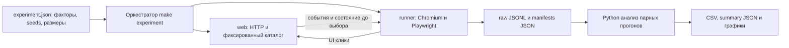

# Практическая работа № 3. Проект экспериментального стенда

Практическая работа 3 по теме ВКР «Исследование эффективности методов адаптации веб-интерфейсов под поведение их пользователей».

В работе спроектирован эксперимент для сравнения трёх вариантов быстрого доступа: фиксированных ссылок, выбора по частоте и выбора по давности обращений. Полный каталог операций во всех вариантах сохраняет свой порядок. Браузерный сценарий будет выполнять заданные последовательности задач, а стенд будет записывать клики, выбранные операции и техническое время. Измерения относятся к работе программы; скорость поиска и удобство для человека потребуют отдельного исследования с участниками. Реализация и результаты относятся к заданию 4 и хранятся в отдельном репозитории `adaptive-ui-stand`.

## 1. Анализ публикаций

### 1.1. Как отобраны исследования

Для обзора я выбрал шесть исследований адаптивных и настраиваемых интерфейсов. Включались работы с доступным полным текстом, описанием исследуемого интерфейса и эмпирической процедурой. Отбирались прежде всего сравнения меню и дополнительные способы доступа к командам, затем исследования персонализации реальных веб-страниц. Год, название и DOI недавних работ сверялись по издательским или институциональным записям. Доступность программного артефакта проверялась отдельно от доступности статьи: PDF с протоколом ещё не даёт возможности запустить тот же эксперимент.

В подборке три основополагающие работы 2004–2008 годов и три публикации 2024–2026 годов. Четыре статьи содержат контролируемые эксперименты: Findlater и McGrenere, две работы Gajos с соавторами и Gaspar-Figueiredo с соавторами. ReLAY и GitUI рассматриваются как исследовательские эмпирические работы, а не как дополнительные контролируемые доказательства причинного эффекта. Публикации CHI, AVI, IUI, PACMHCI и Journal of Systems and Software относятся к рецензируемым научным площадкам.

Воспроизводимость оценивается по шкале задания: 0 означает недостаточное описание метода; 1 означает описанный метод без подтверждённого исполняемого пакета; 2 означает доступные код, стимулы или данные без полностью закреплённой среды; 3 означает доступный артефакт с закреплённой средой. Оценка относится к доступным материалам и не означает, что эксперимент уже удалось повторить. «Не указано» в карточках означает пробел в доступном полном тексте или проверенном артефакте, а не утверждение об отсутствии материалов у авторов.

### 1.2. Findlater и McGrenere, 2004

| Поле анализа | Содержание |
|---|---|
| 1. Библиография, DOI и полный текст | Findlater L., McGrenere J. *A Comparison of Static, Adaptive, and Adaptable Menus*. CHI 2004, pp. 89–96. [DOI 10.1145/985692.985704](https://doi.org/10.1145/985692.985704), [полный текст](https://www.cs.ubc.ca/labs/imager/tr/2004/findlater04menus/findlater04menus.pdf). |
| 2. Вопрос и гипотезы | Как отличаются эффективность и предпочтения для фиксированного, автоматически адаптируемого и вручную настраиваемого split-меню? Проверяется роль типа меню и порядка знакомства с ним. |
| 3. Исследуемая система | Java 1.3.1 на Mac OS 10.1.4; в верхней части меню четыре позиции. В адаптивном варианте команды перемещаются. |
| 4. Независимые переменные и уровни | Menu: static, adaptive, adaptable; три схемы названий команд; порядок предъявления. Adaptive использует две частотные и две недавние команды. |
| 5. Зависимые переменные и единицы | Время блока, с; ошибочные выборы, шт.; ранги предпочтения. |
| 6. Контролируемые условия | Одинаковая структура меню, переименование команд, обязательное исправление ошибок; фиксированное меню заранее оптимизировано по частотам. |
| 7. Стенд и инструменты | eMac G4, Java, Mac OS; лабораторное выполнение выборов меню. |
| 8. Процедура, повторы, порядок и прогрев | 27 студентов 18–39 лет; план внутри участников. По два одинаковых блока из 200 выборов на условие; первый тренировочный. Два латинских квадрата, девять конфигураций. |
| 9. Статистика и результат | ANOVA Order×Menu, Greenhouse–Geisser, Bonferroni; χ² предпочтений. Эффект меню: F(1.44,34.64)=12.54, p<0.001, partial η²=0.343. Во втором блоке static 306.51 с, adaptive 331.62 с, adaptable 318.80 с; эффект настраиваемого варианта зависит от порядка. |
| 10. Угрозы валидности | Статический baseline знает частоты заранее; последовательности взяты из журнала одного человека; студенческая выборка и настольная задача ограничивают перенос. |
| 11. Артефакты | Псевдокод адаптации в статье; проверенного публичного пакета исходников, сырых данных и среды нет. |
| 12. Оценка воспроизводимости | 1/3: метод и версии описаны, исполняемый комплект для повторения не подтверждён. |

Эта работа показывает, почему в новом эксперименте надо точно определить baseline. Первые пять команд исходного каталога и пять наиболее частых команд по всей будущей трассе дают разные сравнения. Второй вариант использует информацию, которой в момент начала работы ещё нет. В собственном стенде статический блок задаётся до генерации результатов и не получает доступ к будущим задачам.

### 1.3. Gajos и соавторы, 2006

| Поле анализа | Содержание |
|---|---|
| 1. Библиография, DOI и полный текст | Gajos K. Z., Czerwinski M., Tan D. S., Weld D. S. *Exploring the Design Space for Adaptive Graphical User Interfaces*. AVI 2006, pp. 201–208. [DOI 10.1145/1133265.1133306](https://doi.org/10.1145/1133265.1133306), [полный текст](https://aiweb.cs.washington.edu/ai/puirg/papers/kgajos-avi06.pdf). |
| 2. Вопрос и гипотезы | Какие выгоды и затраты дают копирование, перемещение и визуальное выделение команд; как результат зависит от алгоритма и точности адаптации? |
| 3. Исследуемая система | Надстройка .NET над Word XP: baseline, Split с копиями, Moving с перемещением, Visual Popout с выделением. |
| 4. Независимые переменные и уровни | Эксперимент 1: четыре UI, frequency/recency, три задачи. Эксперимент 2: baseline/Split/Moving и точность 30/70%. |
| 5. Зависимые переменные и единицы | Время, с; использование адаптивной копии, %; удовлетворённость 1–7; ранги предпочтения. |
| 6. Контролируемые условия | Изоморфные задачи, практика; во втором эксперименте заранее заданные кнопки и точность рекомендации. |
| 7. Стенд и инструменты | Pentium 4, мышь и LCD; эксперимент 1: 3.4 GHz, 1 GB; эксперимент 2: 2.8 GHz, 2 GB. |
| 8. Процедура, повторы, порядок и прогрев | Эксперимент 1: 26 участников 25–55 лет, четыре набора по три задачи, латинский квадрат; UI и задачи внутри участников, алгоритм между участниками. Порядок задач фиксирован. Эксперимент 2: восемь исследователей 25–58 лет, внутри участников, порядок сбалансирован, 52 выбора на пробу; первые 12 исключены. |
| 9. Статистика и результат | RM-ANOVA, Bonferroni, Friedman для предпочтений. Во втором эксперименте Split быстрее baseline, p=0.003; UI×accuracy: F(2,12)=7.689, p=0.007. Использование копии 81.0% и 93.1% при точности 30% и 70%. |
| 10. Угрозы валидности | Малая и специальная выборка второго эксперимента, искусственные выборы; особенности реализации Visual Popout. Стабильность не изолирована от остальных различий UI. |
| 11. Артефакты | Полный текст и схема протокола доступны; проверенный публичный пакет кода, данных и среды не указан. |
| 12. Оценка воспроизводимости | 1/3: достаточно сведений для реконструкции замысла, недостаточно для запуска авторской версии. |

Для проекта я принимаю принцип дополнительной копии: полное меню сохраняет порядок и доступность всех операций. Число быстрых ссылок, равное пяти, является параметром нового стенда. В статье нет доказательства, что именно пять позиций оптимальны для любого веб-приложения.

### 1.4. Gajos и соавторы, 2008

| Поле анализа | Содержание |
|---|---|
| 1. Библиография, DOI и полный текст | Gajos K. Z., Everitt K., Tan D. S., Czerwinski M., Weld D. S. *Predictability and Accuracy in Adaptive User Interfaces*. CHI 2008, pp. 1271–1274. [DOI 10.1145/1357054.1357252](https://doi.org/10.1145/1357054.1357252), [полный текст](https://www.eecs.harvard.edu/~kgajos/papers/2008/kgajos-chi08-predictability.pdf). |
| 2. Вопрос и гипотезы | Влияют ли точность и предсказуемость на выполнение, использование адаптации и удовлетворённость? Авторы ожидали преимущество предсказуемости. |
| 3. Исследуемая система | Модифицированный Word с отдельной панелью копий команд. |
| 4. Независимые переменные и уровни | Точность 50/70%; предсказуемый MRU и случайный порядок. |
| 5. Зависимые переменные и единицы | Время набора, с; медиана выбора, с; использование панели при наличии цели, %; оценки Likert 1–7. |
| 6. Контролируемые условия | Заданные последовательности и случайные панели; восемь кнопок, максимум одна замена за действие, расстояние более 20° зрительного угла. |
| 7. Стенд и инструменты | Pentium 4 2.8 GHz, 2 GB, LCD 18″, мышь; дополнительно eye tracking. |
| 8. Процедура, повторы, порядок и прогрев | 23 участника 21–44 лет; четыре сбалансированных набора по 60 выборов; первые десять исключены; практика с baseline. |
| 9. Статистика и результат | RM-ANOVA логарифмов времени, ordinal logistic regression, Bonferroni 0.05/8. При точности 50/70% время 197/177 с, медиана выбора копии 1.86/1.70 с; F(1,18)=18.081, p<0.001. Использование 70.6/86.4%. Значимого эффекта предсказуемости на время не обнаружено. |
| 10. Угрозы валидности | Искусственная задача, крайний случай случайной панели, пропуски ответов и потеря анкеты; отсутствие эффекта не доказывает эквивалентность. |
| 11. Артефакты | Полный текст; подтверждённый исполняемый пакет и данные для повторного анализа не указаны. |
| 12. Оценка воспроизводимости | 1/3: протокол доступен, закреплённая исполняемая среда не подтверждена. |

Из этой работы переносится определение попадания: цель должна присутствовать в панели **до текущего выбора**. Если сначала добавить выбранную команду в историю, а затем проверить панель, получится утечка ответа. В новом журнале сохраняются история и состав панели на момент выбора, чтобы эту ошибку можно было проверить по данным.

### 1.5. Kim и соавторы, 2026: ReLAY

| Поле анализа | Содержание |
|---|---|
| 1. Библиография, DOI и полный текст | Kim E., Chowdhury S. S., Song H., Suh B. *In-Situ Adaptive Interfaces for Online Browsing: Design Dimensions for Intent-Responsive Automation and User Control*. IUI 2026, pp. 174–196. [DOI 10.1145/3742413.3789092](https://doi.org/10.1145/3742413.3789092), [полный текст](https://gracekim.me/docs/AdaptiveInterfaces.pdf), [институциональная запись](https://snu.elsevierpure.com/en/publications/in-situ-adaptive-interfaces-for-online-browsing-design-dimensions/). |
| 2. Вопрос и гипотезы | Как пользователи принимают адаптации, воспринимают усилие и выбирают степень контроля? Это исследовательские вопросы; причинная гипотеза преимущества перед static не проверяется. |
| 3. Исследуемая система | ReLAY: Chrome extension, React/JavaScript DOM, FastAPI; модели gpt-4o-2024-08-06 и gpt-4.1-2025-04-14. |
| 4. Независимые переменные и уровни | Иерархия секций Yelp, детализация карточек Agoda, порядок элементов Amazon, затем совместное условие; исследовательское и прицельное намерение. Тип адаптации связан с сайтом. |
| 5. Зависимые переменные и единицы | Принятые и отменённые адаптации, события и %; SUS, NASA-TLX, Likert 1–7; интервью. |
| 6. Контролируемые условия | Обучение и задачи заданы; статического baseline нет; сайт и способ адаптации не разделены. |
| 7. Стенд и инструменты | Браузерное расширение, реальные сайты, удалённые сессии и журналы событий. |
| 8. Процедура, повторы, порядок и прогрев | Десять участников 21–32 лет; сессия около 90 минут: tutorial 20, три задачи примерно по десять, совместное условие 20 и интервью 20 минут. Порядок трёх условий рандомизирован; незнакомый сайт изучали две минуты. |
| 9. Статистика и результат | Описательные показатели и качественный анализ. Принято 312 из 362 адаптаций, отменено 50. Это события десяти участников; считать n=362 независимыми наблюдениями нельзя. |
| 10. Угрозы валидности | Малая отобранная выборка, отсутствие baseline, преднастроенные селекторы и меняющийся DOM; не поддерживаются Shadow DOM, iframe и mobile. |
| 11. Артефакты | Prompts, анкеты и изображения в приложениях PDF; публичный runnable code и набор данных не указаны. |
| 12. Оценка воспроизводимости | 1/3: протокол и версии моделей есть, полный исполняемый пакет не подтверждён. |

ReLAY помогает увидеть ограничение автоматической проверки: факт выполнения адаптации ещё не означает её полезность. Авторы исследуют принятие и контроль с помощью людей; браузерный агент таких оценок дать не может. Для собственного стенда полезно и решение откладывать перестройку до перехода на новую страницу: обновление быстрых ссылок тоже будет происходить на границе задачи, а не посреди её выполнения ([ReLAY, §§4.2.2, 7.4](https://gracekim.me/docs/AdaptiveInterfaces.pdf)).

### 1.6. Alves и соавторы, 2024: GitUI

| Поле анализа | Содержание |
|---|---|
| 1. Библиография, DOI и полный текст | Alves S., Costa R., Montague K., Guerreiro T. *Citizen-Led Personalization of User Interfaces: Investigating How People Customize Interfaces for Themselves and Others*. PACMHCI 8, CSCW2, Article 446, 2024, 23 pp. [DOI 10.1145/3686985](https://doi.org/10.1145/3686985), [полный текст](https://techandpeople.github.io/downloads/cscw_citizen_led_personalization.pdf). |
| 2. Вопрос и гипотезы | Как люди настраивают интерфейсы, просят помощь и помогают другим? Формальной причинной гипотезы о лучшем автоматическом алгоритме нет. |
| 3. Исследуемая система | GitUI, расширение Chrome на JS/HTML/CSS и Firebase; девять операций, включая перемещение, перестановку, скрытие и shortcuts. |
| 4. Независимые переменные и уровни | Самостоятельная настройка, запрос и ответ доступны участникам; это действия в естественном использовании, а не рандомизированный фактор. |
| 5. Зависимые переменные и единицы | Шаблоны, запросы, ответы и операции, шт.; интервью; NEO-FFI-20 0–4 и self-efficacy 1–10. |
| 6. Контролируемые условия | Подготовка и минимум использования заданы; сайты выбираются участниками, сопоставимого контрольного условия нет. |
| 7. Стенд и инструменты | Chrome extension, Firebase, домашнее использование и think-aloud. |
| 8. Процедура, повторы, порядок и прогрев | Девять завершивших участников; часовая подготовка, две недели дома, минимум три сайта в неделю. Два пилотных участника включены с одной неделей дома. Фиксированные повторения и сбалансированный порядок не заданы. |
| 9. Статистика и результат | Тематический анализ двумя исследователями, описательная статистика, Pearson для связи личностных черт с активностью; связи не найдены. Из 38 назначенных запросов 36 вымышленные, получен 31 ответ. |
| 10. Угрозы валидности | Мало самостоятельных запросов, короткий период, исследовательское назначение помощи; для трёх участников Chrome не основной браузер. В возрасте есть несогласованность: §3.2 указывает 25–59, Table 1 включает 23 года. |
| 11. Артефакты | [Публичная страница GitUI](https://sergioalves.eu/software/gitUItool) существует, но соответствие текущей версии версии исследования не установлено; точный код и данные эксперимента не указаны. |
| 12. Оценка воспроизводимости | 1/3: протокол доступен, пакет именно исследованной версии не подтверждён. |

GitUI важен для различения adaptive и adaptable: автоматическое правило выбора ссылок и ручная настройка пользователем не являются одним воздействием. Поэтому ручное редактирование панели не включается в текущий эксперимент. Иначе разницу пришлось бы объяснять одновременно алгоритмом, усилием настройки и решениями человека.

### 1.7. Gaspar-Figueiredo и соавторы, 2026

| Поле анализа | Содержание |
|---|---|
| 1. Библиография, DOI и полный текст | Gaspar-Figueiredo D., Vanderdonckt J., Abrahão S., Insfran E. *User experience with adaptive user interfaces: Comparing performance and preferences*. Journal of Systems and Software 231 (2026), 112598. [DOI 10.1016/j.jss.2025.112598](https://doi.org/10.1016/j.jss.2025.112598), [авторский manuscript](https://research.dial.uclouvain.be/server/api/core/bitstreams/7c467e37-30d6-45e0-b2f1-9602573d26fc/content). Год тома 2026; 2025 в DOI не меняет год библиографической записи. |
| 2. Вопрос и гипотезы | Различаются ли время и UX между меню, связаны ли они с ранее измеренными предпочтениями? H0: отсутствие различий и связей. |
| 3. Исследуемая система | Интерактивные PowerPoint-меню с 19 пунктами в контекстах почты и настроек браузера; это стимулы, а не веб-приложение. |
| 4. Независимые переменные и уровни | Menu-Type, 20 уровней: static и 19 адаптивных вариантов. Включены пульсация, жирный шрифт, временное выделение, morphing, ephemeral, подчёркивание, исчезновение вне контекста, split без копий, курсив, highlight, grayscale, rotating, leaf, twisting, glowing, pink, blinking, boxing и adaptive activation area. |
| 5. Зависимые переменные и единицы | Completion-Time, с; EEG-производные Cognitive-Load, Engagement, Memorization 0–100%, Attraction −100…100%; DTW. |
| 6. Контролируемые условия | Одинаковая длина меню, static baseline, контекст и цель закреплены за типом меню; восемь минут EEG-калибровки и тренировка до освоения. |
| 7. Стенд и инструменты | Windows 10, i7, 16 GB, экран 2560×1440; Diadem 24-bit/256 Hz, SennsLab/Cloud/Metrics. |
| 8. Процедура, повторы, порядок и прогрев | 40 участников 18–64 лет; within-subject: 40×20×1=800 trials, одна сессия, один trial на тип; порядок рандомизирован для каждого участника, около десяти секунд отдыха между условиями. Данные собирались в июне–июле 2022 года. |
| 9. Статистическая обработка | Shapiro–Wilk, Brown–Forsythe, ANOVA либо Friedman, Dunn с поправкой, α=0.05; Cohen d/Glass Δ, Spearman/Kendall и cosine similarity. |
| 10. Угрозы валидности | Одиночная короткая задача не показывает обучение; EEG-прокси ограничивают трактовку когнитивных состояний; предпочтения измерены другой выборкой; цель связана с типом меню. |
| 11. Артефакты | [Страница эксперимента](https://resquelab.github.io/pages/experiment-1.html), [стимулы slides.ppsx](https://resquelab.github.io/pages/downloads/instrumentation/slides.ppsx), [данные CSV/XLSX/PZFX](https://github.com/ISSI-DSIC/issi-dsic.github.io/tree/main/pages/downloads/data/Experiment1). Excel-анализ требует Real Statistics; полное измерение требует PowerPoint и EEG/Bitbrain. |
| 12. Оценка воспроизводимости | 2/3: стимулы и данные доступны, полностью закреплённая среда и весь EEG-пайплайн не подтверждены. |

### 1.8. Практика экспериментов в предметной области

В рассмотренных экспериментах эффективность не сводится к самому факту перестройки интерфейса. Findlater и McGrenere получили преимущество оптимизированного фиксированного меню над автоматически меняющимся. Gajos с соавторами показали, что способ предъявления адаптации и попадание нужной команды в дополнительную панель связаны с результатом. Эти наблюдения совместимы: хороший прогноз ещё не устраняет стоимость изменения расположения, а постоянный удобный baseline способен оставить мало пространства для улучшения. Следовательно, утверждение «адаптация эффективнее» требует назвать конкретную политику, исходное меню, распределение задач и измеряемый эффект ([Findlater, McGrenere, 2004](https://doi.org/10.1145/985692.985704); [Gajos et al., 2006](https://doi.org/10.1145/1133265.1133306); [Gajos et al., 2008](https://doi.org/10.1145/1357054.1357252)).

Принятая в этих работах практика включает повторные измерения у одного участника, тренировку перед измерением и контроль порядка предъявления. Это уменьшает смешение воздействия с обучением и индивидуальными различиями. Однако повторные выборы одного человека не превращаются в независимых людей. Для синтетического стенда соответствующей единицей становится независимая последовательность задач, заданная seed. Сравнивать политики надо на одной последовательности, сохраняя парность, а неопределённость оценивать между последовательностями. Повторный технический запуск той же последовательности отвечает уже на вопрос повторяемости среды. Разделение этих двух источников вариации не позволяет искусственно увеличить размер выборки.

При выборе метрик важно различать работу человека и браузерного сценария. Время человека в Word или PowerPoint включает поиск, принятие решения и движение. Время Playwright включает работу драйвера, ожидание готовности элемента и выполнение браузером клика. Совпадение единиц, секунд или миллисекунд, не делает эти показатели взаимозаменяемыми. Точно так же EEG, SUS и NASA-TLX нельзя получать от автоматического агента. Поэтому я выбираю число реально выполненных кликов как основной исход, попадание в быстрый доступ как объяснение механизма и техническое время как характеристику реализации ([Gajos et al., 2008](https://doi.org/10.1145/1357054.1357252); [Gaspar-Figueiredo et al., 2026](https://doi.org/10.1016/j.jss.2025.112598)).

Частая ошибка такого проекта состоит в выборе слишком удобной модели доступа. Если любой пункт уже виден и требует один клик, быстрый доступ тоже требует один клик; качество ранжирования не изменит число действий. В моём стенде полный каталог открывается отдельной кнопкой и разбит на страницы. Это объявленное свойство исследуемого интерфейса, которое создаёт возможную экономию. Оно же ограничивает вывод: полученная величина зависит от глубины доступа. Нельзя скрывать стоимость каталога или добавлять роботу вымышленную задержку «на размышление», чтобы получить желаемое время.

Другой риск связан с baseline, настроенным по всей будущей трассе. Такой вариант можно использовать как отдельную теоретическую границу, но нельзя выдавать за обычное начальное меню. Аналогичная утечка возникает при обновлении панели до проверки текущего попадания. В проекте общий начальный набор фиксирован заранее, а история изменяется только после завершённой задачи. Для изменения интересов задаётся самостоятельный сценарий drift: обучение на прежних целях не должно маскировать ухудшение после смены спроса. Равномерный сценарий нужен, чтобы не строить вывод исключительно на благоприятной концентрации запросов.

Недавние ReLAY и GitUI расширяют предмет исследования. Людям важны возможность отмены изменения, соответствие намерению и затраты ручной настройки. Но эти работы не дают причинного сравнения частотного и давностного правила на одинаковой веб-навигации. Для проекта эти работы задают границы автоматической проверки. Следующий этап ВКР с участниками должен проверять принятие панели и стоимость освоения, а не только воспроизводить уже измеренные клики ([Kim et al., 2026](https://doi.org/10.1145/3742413.3789092); [Alves et al., 2024](https://doi.org/10.1145/3686985)).

Наконец, хорошее описание метода и наличие артефакта дают разный уровень проверяемости. В пяти карточках можно реконструировать протокол, но нельзя подтвердить запуск той же версии системы. JSS предоставляет стимулы и данные, что позволяет проверить больше звеньев анализа, хотя для полного измерения требуется специальная среда. Для собственного стенда я принимаю более узкую задачу и делаю её исполняемой целиком: генератор, веб-интерфейс, браузерный сценарий и анализ поставляются вместе. Поэтому в проекте сравниваются все сочетания политик и сценариев. Для каждой политики сохраняются одинаковые входные последовательности и журналы действий.

## 2. Исследовательский вопрос и критерии научности

### 2.1. Объект и проверяемые гипотезы

Объект исследования: навигация по веб-каталогу операций. Сравнивается влияние двух правил выбора быстрых ссылок на число кликов и техническое время выполнения задач. Система записывает обращения к операциям, обновляет историю и выбирает ссылки для следующей задачи. Поведение человека при поиске пункта здесь не моделируется.

Исследовательский вопрос: при каких синтетических распределениях спроса выбор пяти быстрых ссылок по накопленной частоте или давности сокращает число кликов относительно фиксированных пяти ссылок и как меняются попадания и техническое время при резкой смене популярных целей?

Для каждой пары «адаптивная политика, сценарий» определяется D как среднее число кликов static минус среднее число кликов адаптивной политики на одной и той же трассе. Направленная гипотеза пользы имеет вид H0: E(D)≤0; H1: E(D)>0. Основная содержательная проверка относится к frequency в stable; остальные пять сравнений заранее включены в семейство проверок устойчивости. Для вывода о практически заметном выигрыше дополнительно требуется нижняя граница 95%-го парного bootstrap-интервала выше 0.25 клика на задачу. Соответствующая практическая H0: E(D)≤0.25; H1: E(D)>0.25. Двусторонний тест перестановки знаков проверяет отличие от нуля; сам по себе он не проверяет преодоление 0.25.

**Порог 0.25 клика на задачу выбран мной как инженерный критерий**, а не взят из статей. Действия дискретны: такой выигрыш означает в среднем не менее одного сохранённого клика на четыре задачи. Он достижим при объявленной глубине каталога и не требует стопроцентного попадания. В литературе обоснованы измерение попаданий, времени и способов представления адаптации, но нет универсального порога, который делал бы четверть клика нормативом удобства. Для технического времени заранее не задаётся UX-порог; оно описывается отдельно и не используется для вывода об ускорении людей.

### 2.2. Факторы, показатели и контроль

| Переменная | Операциональное определение |
|---|---|
| Политика, три уровня | static: операции 0–4; frequency: пять максимальных накопленных частот, при равенстве меньший исходный индекс; recency: пять последних различных операций в порядке давности. До истории все начинают с 0–4. Recency не использует затухание весов. |
| Сценарий, три уровня | stable: устойчивый перекос к заранее заданной пятёрке; drift: после половины измеряемых задач популярной становится другая пятёрка; uniform: равновероятный выбор из 40 операций. |
| Основной исход | Среднее число зарегистрированных UI-кликов на измеряемую задачу, клики/задачу. Правильная цель проверяется отдельно; ошибки не удаляются из набора молча. |
| Попадание | Цель есть в быстрых ссылках перед текущим выбором; доля среди измеряемых задач, %. Агент при наличии цели всегда использует быстрый доступ. |
| Техническое время | От начала маршрута кликов агента до завершения выбора, мс/задачу; включает Playwright и браузерные ожидания. Формирование и отрисовка панели до начала маршрута в этот таймер не входят. Это не время выполнения человеком и не отдельное время вычисления адаптации. |
| Смена спроса | Средние клики до и после середины измеряемой части; отдельное описательное сравнение для drift. |
| Контроль корректности | Фактическая цель, число событий выбора, история до выбора, ошибки страницы, полнота задач, соответствие конфигурации. |
| Контролируемые условия | Каталог, подписи и исходный порядок, пять ссылок, восемь операций на странице, viewport 1280×900, версия Chromium, CPU/память, последовательный запуск, начальная история, отсутствие внешней сети при задачах. |

Количество кликов считается по обработчикам интерфейса, а не подставляется из математической формулы. Попадание даёт один клик. Непопадание для первой страницы требует открытия каталога и выбора, а для остальных ещё переключения страницы. Каталог в начале каждой задачи закрыт и установлен на первую страницу. Поэтому ожидаются маршруты длиной один, два или три клика. Проверка этих трёх маршрутов будет калибровкой счётчика. По журналу проверяются фактически выполненный путь, правильность цели и состояние истории перед выбором.

Объективность обеспечивается внешне проверяемыми исходами: событием клика, ID выбранной операции, таймером и сохранённой историей. Управляемость означает изменение только политики при одинаковых входах и ограничениях. Повторяемость проверяется вторым запуском на тех же seeds в той же среде. Воспроизводимость проверяется запуском пакета другим человеком по README. Репликация предполагает, что другой исследователь самостоятельно реализует описанные протокол, генератор и интерфейс и проверит согласованность выводов. Второй запуск нашего контейнера этого не заменяет. Изменение структуры каталога отдельно проверяет внешнюю валидность. Фальсифицируемость состоит в возможности получить D≤0, интервал ниже практического порога либо ошибку корректности; в таком случае положительная гипотеза не подтверждается.

## 3. Проект стенда и проверяемость результатов

### 3.1. Компоненты и поток данных



| Компонент | Планируемая технология и версия | Ресурсы и роль | Основание решения |
|---|---|---|---|
| Общий образ | Playwright Python 1.56.0, Ubuntu Noble; базовый образ `mcr.microsoft.com/playwright/python:v1.56.0-noble`, digest в `Dockerfile` реализации | Одна сборка для web и runner | Единая среда уменьшает неоднозначность версии браузера; нехватка исполняемых пакетов обнаружена при разборе пяти работ. |
| web | Python стандартная библиотека, HTML/CSS/JavaScript без внешних пакетов | 1 CPU, 256 MiB, HTTP 8000; локальный preview 8040 | Небольшой каталог позволяет изолировать способ доступа. Копирование сохраняет исходные команды, как в Split ([Gajos et al., 2006](https://doi.org/10.1145/1133265.1133306)). |
| runner | Playwright 1.56.0 и Chromium из того же образа | 2 CPU, 2 GiB, shared memory 1 GiB; один активный сценарий | Браузер выполняет реальные клики, конечная цель и история проверяются независимо от агрегатов. |
| Анализ | NumPy 2.2.6, SciPy 1.15.3, Matplotlib 3.10.3 | В контейнере runner, локальные файлы | Парные сравнения сохраняют связь одинаковых трасс, графики показывают распределения; необходимость контроля повторных измерений следует из экспериментальных планов рассмотренных работ. |
| Оркестрация | Docker Compose, Make, Python 3 на хосте | Сборка, healthcheck, запуск, остановка | Чужой исследователь получает команду выполнения полного цикла; JSS показывает ценность публикации стимулов и данных ([артефакт](https://resquelab.github.io/pages/experiment-1.html)). |

Базовая платформа стенда: Apple M2, 8 GiB RAM, macOS 26.5.1 с Docker Desktop. Пределы CPU и памяти сервисов приведены в таблице; реальные параметры VM фиксируются при запуске.

Для базового образа фиксируется digest `sha256:a7f6cf3ae520c9d670ad956572c13747ed5abdbba5123a01526f873ed1662528`. Схема компонентов отдельно сохранена в [architecture.mmd](architecture.mmd).

HTTP-сервис не хранит пользовательские данные: история находится в новом браузерном контексте каждого прогона. Внешние сайты и API в ходе измерения не нужны. Сеть Compose соединяет runner с web; публикация web на loopback нужна только для просмотра. Загрузка базового образа и Python-пакетов выполняется на этапе сборки. Ограничения контейнеров фиксируются в Compose, но не означают одинаковую производительность разных хостов, поэтому сведения о хосте и фактических cgroup-лимитах должны попадать в manifest.

### 3.2. Фиксация условий и данных

| Уровень | Что закрепляется и как проверяется |
|---|---|
| 1. Код | Git SHA и статус рабочей копии в manifest; изменённый исходник требует нового набора результатов. Для копии без Git явно записывается отсутствие версии. |
| 2. Зависимости | Версии прямых Python-зависимостей в requirements и транзитивных в requirements.lock; в manifest сохраняется pip freeze. Прямые pins сами по себе не считаются полным lockfile. |
| 3. Образы | Digest исходного Playwright-образа в Dockerfile, ID и inspect собранного образа в manifest. Изменение образа считается изменением среды. |
| 4. Данные | Сохраняются полные последовательности целей и raw JSONL; контрольные SHA256 позволяют обнаружить изменение набора после анализа. |
| 5. Конфигурация | Копия параметров и SHA256 experiment.json для каждого прогона; одна конфигурация на весь пакет. |
| 6. Случайность | Базовый seed, seed трассы и seed рандомизации порядка; повторный пакет использует те же трассы, но новый порядок. |
| 7. Одна команда | make experiment собирает образ, ждёт web, выполняет все прогоны, анализирует и сохраняет результат. Ручной подбор удачных прогонов исключён из протокола. |
| 8. Manifest | Время начала и конца, порядок, версия браузера, параметры, аппаратная среда, ресурсы, ошибки и полнота задач связывают каждую строку с запуском. |
| 9. Политика CI | В CI достаточно сборки и короткой проверки маршрутов без сравнения миллисекунд с другой машиной; полный эксперимент запускается в закреплённой среде. CI является возможным дополнением, а не условием научной значимости. |

Предполагаемая структура проекта отделяет исходники от данных. В `web/` находятся интерфейс и HTTP-сервер, в `runner/` выполнение и анализ, в `configs/` параметры. `scripts/run.py` и `Makefile` обеспечивают запуск. [Протокол](configs/protocol.md) и SHA256 конфигурации фиксируются до измерений. В `results/<идентификатор>/raw/` хранятся события, в `manifests/` паспорта прогонов, в `figures/` рисунки; рядом сохраняются `per-run.csv`, `summary.json` и описание анализа. В репозитории `adaptive-ui-design` находятся проект и конфигурация, а в `adaptive-ui-stand` будут код, результаты и отчёт о выполнении эксперимента.

```text
adaptive-ui-stand/
  Dockerfile
  compose.yaml
  Makefile
  README.md
  configs/experiment.json
  web/index.html
  web/server.py
  runner/requirements.txt
  runner/experiment.py
  runner/analysis.py
  scripts/run.py
  results/<идентификатор>/{raw,manifests,figures}/
  REPORT.md
```

Следующие команды выполняются в репозитории реализации `adaptive-ui-stand`. Проверка начинается с `docker compose config`: команда должна успешно разобрать оба сервиса и ограничения ресурсов. Затем `make experiment` должен завершиться с кодом 0, создать указатель `results/latest.json` и полный пакет файлов. Передача проекта и запуск описаны в `README.md` репозитория реализации. После перехода в найденный каталог проверяется `summary.json`: требуется `integrity.pass=true`, полное число задач и отсутствие потерь. Повторное выполнение `make experiment` создаёт отдельный каталог, а не перезаписывает исходный набор.

Для детерминированных кликов и попаданий допуск между повторами на одинаковых трассах равен нулю. Ошибочных целей и пропущенных задач также должно быть ноль. Для технических миллисекунд равенство не ожидается: сравниваются интервалы и разброс A/A, а отклонение не скрывается под произвольным «допуском 5%». Для запуска на другом хосте совпадение кликов является проверяемым ожиданием, тогда как равенство времени не является критерием успешного воспроизведения.

## 4. План эксперимента

### 4.1. Факторный эксперимент и калибровка

Основной план содержит три политики, три сценария, десять независимых seeds и две серии выполнения: 3×3×10×2=180 прогонов. В каждом прогоне сначала выполняются пять технических warm-up задач; затем история и журнал сбрасываются. Далее идут 20 задач накопления истории и 24 измеряемые задачи. Прогрев браузера таким образом не подменяет обучение алгоритма. Длительность прогона определяется выполнением конечной последовательности, без искусственной задержки на «реакцию». Время измеряется, а не устанавливается заранее.

В stable и drift 85% выборов направлены на заданную популярную пятёрку, оставшиеся 15% выбираются равномерно из всего каталога, поэтому итоговая вероятность пятёрки немного выше 85%. В drift новая пятёрка включается после 20 обучающих и 12 измеряемых задач. Обе пятёрки заранее определены и не пересекаются; они не совпадают с исходными static 0–4. Это проверяет работу адаптации при неудачном для данного спроса начальном блоке, а не средний эффект по всем возможным начальным меню. Uniform выбирает каждую из 40 целей с равной вероятностью.

Порядок 90 прогонов каждой серии перемешивается заранее по seed. Политики работают последовательно, с новым browser context; параллельная конкуренция за CPU не вводится. Второй пакет использует те же десять seeds и новый порядок. Его назначение состоит в проверке повторяемости кликов и оценке технической изменчивости; складывать серии в n=20 нельзя. В основном выводе n=10 парных трасс на сравнение.

Отдельная A/A-проверка содержит десять прогонов static, то есть пять пар одинаковых трасс с независимыми от основного плана seeds. Она проверяет, создаёт ли сама процедура сравнения различия в действиях и насколько шумно техническое время. При равенстве кликов ожидается нулевая парная разность. Значение p>0.05 для времени не доказывает эквивалентность: при пяти парах мощность мала, поэтому публикуются сам разброс и доверительный интервал. Дополнительно выполняются три разведочных cold-start прогона без 20 обучающих задач; они описываются отдельно, без присоединения к основной выборке.

Перед основным запуском проверяются маршруты на один, два и три клика, начальные пять ссылок и обновление истории после выбора. CPU runner и Chromium регистрируется совместно по cgroup примерно каждые 200 мс; средняя загрузка сравнивается с выделенными двумя CPU. Запас CPU помогает выявить грубое насыщение генератора, но не доказывает отсутствие влияния автоматизации, а короткие пики между отсчётами могут быть пропущены. Это ограничение остаётся в отчёте даже при успешной диагностике. Отдельно проверяется скорость Python-генератора на 10000 последовательностей; сохраняются число сгенерированных задач и длительность. Эта проверка выявляет грубую стоимость генерации, но не заменяет анализ CPU при работе браузера.

### 4.2. Анализ и заранее принятые правила решения

Анализ сначала агрегирует 24 измеряемые задачи каждого прогона, затем сравнивает политики попарно по одинаковым seeds. Доверительный интервал средней экономии строится парным percentile bootstrap с 5000 перевыборками seeds. Для n=10 точный двусторонний тест перестановки знаков перебирает 1024 набора знаков парных разностей. Его применимость предполагает обменность знаков при нулевой гипотезе; для асимметричных распределений это допущение следует учитывать. Дополнительный Wilcoxon описывает согласованность направления парных сдвигов, но не является тестом среднего выигрыша.

Для шести сравнений «две адаптивные политики, три сценария» в пределах серии используется поправка Holm с α=0.05. Публикуются исходные и скорректированные p, абсолютная средняя экономия, интервал, парные разности и стандартизованный эффект dz. Если дисперсия разностей нулевая, dz не вычисляется и это указывается явно. Практическое решение опирается на порог 0.25 и интервал; при утверждении статистически значимого преимущества также требуется Holm p<0.05. Интервалы являются отдельными 95%-ми интервалами для каждой пары, а не одновременными интервалами для всего семейства. Статистическая значимость малого эффекта не подменяет практический критерий.

Рисунок с boxplot и точками показывает десять средних каждого сочетания в первой серии. ECDF технического времени показывает распределение задач как описание измерений; точки внутри трассы зависимы и не используются как независимая выборка для проверки гипотез. График показателей по порядку запуска нужен для поиска прогрева или дрейфа среды. Корреляции с порядком относятся к разведочному анализу, поэтому их нельзя использовать как заранее подтверждённые гипотезы.

Все неудачные прогоны и ошибки сохраняются. Если не выполнены проверки целостности, набор помечается как неуспешный, а причина устраняется до нового полного запуска. Результат старого запуска не подменяется исправленным без следа. Конфигурация, гипотеза и порог фиксируются до чтения итоговых сравнений; подбор seed, длины обучения или популярной пятёрки по красивому результату потребовал бы нового подтверждающего эксперимента.

### 4.3. Угрозы валидности

| Вид валидности | Угроза | Принятый контроль и остающееся ограничение |
|---|---|---|
| Внутренняя | Разные цели, сохранённая история, утечка текущего ответа, порядок запуска | Одинаковые seeded трассы, новые контексты, история до выбора, перемешивание порядка; системная нагрузка хоста полностью не устраняется. |
| Конструктная | Клики или миллисекунды названы удобством для человека | Вывод ограничен длиной маршрута и техническим выполнением. Поиск, доверие, освоение, субъективная нагрузка и UX не измеряются. |
| Внешняя | 40 операций, пять ссылок, короткие синтетические сессии и заданные популярные цели не представляют любой сайт | Все параметры открыты; stable, drift и uniform анализируются отдельно. Для обобщения нужны другая структура и реальные участники. |
| Статистических выводов | Псевдорепликация задач, n=10, несколько сравнений, асимметрия разностей | Единица анализа seed, bootstrap по парам, Holm, интервалы и размеры эффекта; две серии не объединяются. Малый набор не исключает пропуск небольшого эффекта. |

## 5. Выводы

Проект сравнивает три способа формирования быстрых ссылок на одинаковых последовательностях задач. Стабильный спрос, смена предпочтений и равномерный выбор позволяют проверить, при каких условиях история обращений помогает сократить путь. Для каждого прогона сохраняются события, конфигурация и сведения об окружении; итоговые показатели можно будет проследить до конкретного выбора.

Результат будет оцениваться по заранее установленному порогу и разбросу между независимыми последовательностями. При достижении порога следующим шагом станет исследование с участниками: нужно проверить, сохраняется ли экономия при поиске человеком и не перекрывается ли она затратами на освоение меняющейся панели. Если выигрыш исчезнет после смены спроса или не достигнет порога, потребуется пересмотреть условия применения правила либо сам алгоритм.

## 6. Список литературы

1. Findlater L., McGrenere J. *A Comparison of Static, Adaptive, and Adaptable Menus*. CHI 2004, pp. 89–96. [DOI 10.1145/985692.985704](https://doi.org/10.1145/985692.985704), [полный текст](https://www.cs.ubc.ca/labs/imager/tr/2004/findlater04menus/findlater04menus.pdf).
2. Gajos K. Z., Czerwinski M., Tan D. S., Weld D. S. *Exploring the Design Space for Adaptive Graphical User Interfaces*. AVI 2006, pp. 201–208. [DOI 10.1145/1133265.1133306](https://doi.org/10.1145/1133265.1133306), [полный текст](https://aiweb.cs.washington.edu/ai/puirg/papers/kgajos-avi06.pdf).
3. Gajos K. Z., Everitt K., Tan D. S., Czerwinski M., Weld D. S. *Predictability and Accuracy in Adaptive User Interfaces*. CHI 2008, pp. 1271–1274. [DOI 10.1145/1357054.1357252](https://doi.org/10.1145/1357054.1357252), [полный текст](https://www.eecs.harvard.edu/~kgajos/papers/2008/kgajos-chi08-predictability.pdf).
4. Kim E., Chowdhury S. S., Song H., Suh B. *In-Situ Adaptive Interfaces for Online Browsing: Design Dimensions for Intent-Responsive Automation and User Control*. IUI 2026, pp. 174–196. [DOI 10.1145/3742413.3789092](https://doi.org/10.1145/3742413.3789092), [полный текст](https://gracekim.me/docs/AdaptiveInterfaces.pdf), [институциональная запись](https://snu.elsevierpure.com/en/publications/in-situ-adaptive-interfaces-for-online-browsing-design-dimensions/).
5. Alves S., Costa R., Montague K., Guerreiro T. *Citizen-Led Personalization of User Interfaces: Investigating How People Customize Interfaces for Themselves and Others*. PACMHCI 8, CSCW2, Article 446, 2024, 23 pp. [DOI 10.1145/3686985](https://doi.org/10.1145/3686985), [полный текст](https://techandpeople.github.io/downloads/cscw_citizen_led_personalization.pdf).
6. Gaspar-Figueiredo D., Vanderdonckt J., Abrahão S., Insfran E. *User experience with adaptive user interfaces: Comparing performance and preferences*. Journal of Systems and Software 231 (2026), 112598. [DOI 10.1016/j.jss.2025.112598](https://doi.org/10.1016/j.jss.2025.112598), [авторский manuscript](https://research.dial.uclouvain.be/server/api/core/bitstreams/7c467e37-30d6-45e0-b2f1-9602573d26fc/content). Год тома 2026; 2025 в DOI не меняет год библиографической записи.
