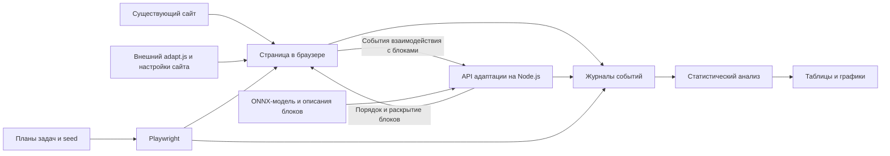

# Проект неявной адаптации веб-каталога

Практическая работа № 3. Курс «Проектирование и развертывание веб-решений в экосистеме Python».
Тема ВКР: «Исследование эффективности методов адаптации веб-интерфейсов под поведение их пользователей».

Планируется сравнить частотно-давностную и семантическую адаптацию страницы отдельной квартиры. Для этого проектируется внешний JavaScript-скрипт с отдельным бэкендом на Node.js. По истории взаимодействий он будет менять порядок разделов и их раскрытие. В контрольном варианте будет подключён тот же скрипт с фиксированным начальным расположением блоков.


## 1. Литература

Для обзора выбрал шесть работ. Четыре опубликованы в 2024–2026 годах, пять прошли рецензирование на CHI или IUI, одна доступна как препринт. В работах Todi, Gajos, Jelly, DynaVis и Generative UI проводились эксперименты; в первых двух и DynaVis участники сравнивали разные варианты интерфейса. В ReLAY изучались действия и впечатления пользователей, но сравнения с фиксированным интерфейсом не было.

Шкала воспроизводимости: 0 (нельзя повторить даже идею), 1 (методика без артефактов), 2 (код или данные без закреплённого окружения), 3 (артефакт с закреплённым окружением).

### Источники

**Todi, 2021.** Todi K., Bailly G., Leiva L. A., Oulasvirta A. *Adapting User Interfaces with Model-based Reinforcement Learning*. CHI 2021, art. 573, 13 pp. [DOI](https://doi.org/10.1145/3411764.3445497), [текст](https://userinterfaces.aalto.fi/adaptive/resources/chi2021-todi-adaptive.pdf).

**Gajos, 2008.** Gajos K. Z., Everitt K., Tan D. S., Czerwinski M., Weld D. S. *Predictability and Accuracy in Adaptive User Interfaces*. CHI 2008, pp. 1271–1274. [DOI](https://doi.org/10.1145/1357054.1357252), [текст](https://www.eecs.harvard.edu/~kgajos/papers/2008/kgajos-chi08-predictability.pdf).

**ReLAY, 2026.** Kim E., Chowdhury S. S., Song H., Suh B. *In-Situ Adaptive Interfaces for Online Browsing: Design Dimensions for Intent-Responsive Automation and User Control*. IUI 2026, pp. 174–196. [DOI](https://doi.org/10.1145/3742413.3789092), [текст](https://gracekim.me/docs/AdaptiveInterfaces.pdf), [сведения о рецензировании](https://snu.elsevierpure.com/en/publications/in-situ-adaptive-interfaces-for-online-browsing-design-dimensions/).

**Jelly, 2025.** Cao Y., Jiang P., Xia H. *Generative and Malleable User Interfaces with Generative and Evolving Task-Driven Data Model*. CHI 2025, 20 pp. [DOI](https://doi.org/10.1145/3706598.3713285), [текст](https://hci.ucsd.edu/papers/jelly.pdf).

**DynaVis, 2024.** Vaithilingam P., Glassman E. L., Inala J. P., Wang C. *DynaVis: Dynamically Synthesized UI Widgets for Visualization Editing*. CHI 2024, 17 pp. [DOI](https://doi.org/10.1145/3613904.3642639), [текст](https://glassmanlab.seas.harvard.edu/papers/dynavis.pdf).

**Generative UI, 2026.** Leviathan Y. et al. *Generative UI: LLMs are Effective UI Generators*. arXiv:2604.09577v1, 2026, 23 pp., препринт. [Запись](https://arxiv.org/abs/2604.09577), [текст](https://arxiv.org/pdf/2604.09577v1).

### Что исследовали

| Работа | Вопрос | Система | Что сравнивали авторы |
|---|---|---|---|
| Todi, 2021 | Может ли планирование улучшить адаптацию и время выбора относительно фиксированного интерфейса и адаптации по частоте использования? Формальные H0/H1 не указаны. | Поиск по дереву методом Монте-Карло (MCTS), модели взаимодействия человека с компьютером и нейросеть оценки вариантов; перестановки и группировки меню, без языковой модели. | С участниками сравнивали три варианта: фиксированное меню, выбор команд по частоте использования и метод MCTS. Отдельно в симуляции меняли число пунктов меню (5, 10 или 15), использовали 8 историй обращений и 4 раскладки. Алгоритм оценивал последствия изменений на 4, 6, 8 или 10 шагов вперёд. |
| Gajos, 2008 | Улучшают ли точность и предсказуемость выполнение, использование панели и удовлетворённость? | Word-подобный интерфейс, восемь адаптивных копий команд при сохранении исходных команд; без машинного обучения и языковых моделей. | Каждый участник работал с четырьмя вариантами панели: последние использованные команды при точности 50%; последние использованные команды при точности 70%; случайный набор при точности 50%; случайный набор при точности 70%. Точность здесь означает долю заданий, в которых нужная кнопка уже есть на панели. |
| ReLAY, 2026 | Как принимаются изменения, воспринимаются усилия и выбирается контроль? Количественных H0/H1 нет. | ReLAY: расширение Chrome, React/JS, FastAPI, gpt-4o-2024-08-06 и gpt-4.1-2025-04-14; большая языковая модель (LLM) определяет намерение по нажатиям, поиску, переходам, длительности просмотра, прокрутке и структуре страницы (DOM). | На Agoda меняли количество видимых подробностей, на Yelp порядок разделов, на Amazon порядок элементов с учётом истории просмотра. На четвёртом сайте, 29cm, изменения проверяли вместе. Участники свободно изучали сайты или искали с определённой целью; намерение не назначалось случайно. |
| Jelly, 2025 | Полезны ли представление и изменение информации; где возникают ошибки? Формальных направленных гипотез нет. | Jelly строит объектно-реляционную схему данных, зависимости и интерфейс на React по явному запросу. | Для 25 сценариев сравнивали результаты менее и более подробного запроса. Участники выполняли по две свободные задачи в Jelly; другого инструмента для сравнения не было. |
| DynaVis, 2024 | Снижают ли генерируемые элементы управления усилия редактирования и когда их предпочитают? Формальные H не выделены. | Команда на естественном языке меняет визуализацию и создаёт постоянный элемент управления. | Каждый участник пробовал два варианта: готовые элементы управления с командами на естественном языке (UINL) и тот же вариант с генерацией новых элементов управления (UIDW). Использовали данные об акциях, безработице и погоде, по пять подзадач. Порядок работы с вариантами и задачами был сбалансирован случайным назначением. |
| Generative UI, 2026 | Предпочитают ли оценщики страницу обычному выводу LLM; как влияют модель и инструкция? Формальные H не выделены. | Gemini генерирует HTML/JS и медиафайлы для явного запроса. | На одни запросы сравнивали пять видов ответа: сайт эксперта, сгенерированный интерфейс, Markdown, поисковую выдачу и обычный текст. Дополнительно проверяли пять семейств моделей и три инструкции: полную, сокращённую и без общих рекомендаций по дизайну. |


### Измерения и условия

| Работа | Показатели | Контроль | Инструменты и среда |
|---|---|---|---|
| Todi, 2021 | Время выбора, мс; ошибки, шт.; предсказанное улучшение, %; время вычисления, с. | 15 пунктов в исследовании с участниками, распределение Ципфа с параметром 1.5, одинаковое распределение внутри участника, непересекающиеся названия, адаптация между блоками, обязательный правильный ответ. | Python 3.7, TensorFlow 2.0.0, GNU/Linux Xeon Gold 2.10 GHz; исследование с участниками на 15″ MacBook Pro Retina с Magic Mouse и HTML/JS. Версии браузера/ОС не указаны. |
| Gajos, 2008 | Время задания и выбора, с; использование панели, %; шкала Лайкерта 1–7; восприятие точности, %; переводы взгляда, %. | Заранее заданные последовательности и состав панелей, максимум одна замена за действие, восемь кнопок, расстояние до исходных команд >20° поля зрения. | Pentium 4 2.8 GHz, 2 GB, LCD 18″, мышь; модель устройства отслеживания взгляда не указана. |
| ReLAY, 2026 | Принятие/отмена, шт. и %; время до отмены автоматического изменения, с; опросник нагрузки NASA-TLX, шкала Лайкерта 1–7, опросник удобства SUS, интервью. | Обучение, отмена/отключение адаптации; фиксированного варианта нет, способ адаптации смешан с сайтом. | Удалённый Chrome/Zoom на ноутбуках участников либо подготовленном ноутбуке; оборудование, версии ОС/Chrome, параметры генерации и задержка API не указаны. |
| Jelly, 2025 | Категории релевантности сущностей/атрибутов; корректность зависимостей, %; шкала Лайкерта 1–5, изменения и ошибки. | Парные менее/более подробные запросы; в исследовании с участниками нет контрольного инструмента. | Сервер на Python, Claude 3.5 Sonnet/GPT-4o, JSON, примеры в инструкции модели и проверки совместимости; точные версии моделей и оборудование не подтверждены. |
| DynaVis, 2024 | Успех, время, мин:с; команды и действия, шт.; шкала Лайкерта, NASA-TLX, предпочтение, ошибки/задержки. | UINL уже поддерживает естественный язык и готовые элементы управления; UIDW добавляет их генерацию. Варианта только с готовыми элементами управления нет. | React/TypeScript, Flask, pandas/LIDA, Vega-Lite v5, GPT-3.5-turbo, проверка синтаксического дерева, компиляция и исправление кода; точная версия модели и оборудование не указаны. |
| Generative UI, 2026 | Парные оценки: предпочтение левого варианта, правого или ничья, Elo, ошибки; человеческое время выполнения задачи не измеряется. | Одинаковые запросы и сохранённые результаты; генерация исключена из сравнения; рандомизация сторон и точные версии моделей не раскрыты. | Gemini, сервер инструментов поиска и работы с изображениями, системные инструкции и последующая обработка; среда генерации не закреплена. |

### Процедура и результаты

| Работа | Процедура | Анализ и результат | Ограничения |
|---|---|---|---|
| Todi, 2021 | 18 участников; одни и те же участники проходят все условия, латинский квадрат 3×3; 3 условия × 3 блока × 2 меню × 20 выборов, всего 6480 выборов; паузы 3 с/1 мин/5 мин на разных уровнях. Отдельный исключаемый прогрев не указан. | Дисперсионный анализ повторных измерений со смешанными эффектами, F(2,17)=5.47, p<.05; тест Тьюки (HSD): MCTS 2162 мс, фиксированный вариант 2283, частотная адаптация 2298. Успех симуляции 92.7%/89.6% нельзя приписывать людям. | Узкая лабораторная задача, стационарный синтетический спрос, зависимость симуляции от модели взаимодействия человека с компьютером; нет LLM или полей карточек. |
| Gajos, 2008 | 23 участника; практика без адаптации, четыре сбалансированных набора по 60 выборов, первые десять исключены; менее часа. Анализ движений глаз: 22 набора у 16 участников. | Дисперсионный анализ повторных измерений для времени после логарифмирования, порядковая логистическая регрессия, поправка Бонферрони .05/8. При точности 50/70% среднее время задания 197/177 с, использование 70.6/86.4%; значимого выигрыша времени от предсказуемости не обнаружено. | Искусственные цели и точность, случайность как крайнее приближение непрозрачной адаптации, малая подвыборка с записью движений глаз, пропуски. |
| ReLAY, 2026 | 10 участников 21–32 лет, около 90 мин: обучение 20 мин, три задачи по 10, совместное условие 20, интервью 20; первые три условия рандомизированы, незнакомый сайт изучают ещё 2 мин. | Качественный и описательный анализ: 312/362 изменений не отменены, 50 отменены; доверительных интервалов и проверки причинного эффекта нет. События не образуют n=362 независимых участников. | Небольшое поисковое исследование без контрольного варианта; точность распознавания намерения независимо не проверялась, принятие изменений не доказывает пользу. Структура страниц подготовлена заранее; мобильные страницы и изолированные деревья элементов (Shadow DOM) не поддерживаются; шкала SUS в приложении описана неоднозначно. |
| Jelly, 2025 | Технически 197 сущностей, 1052 атрибута, 232 зависимости; два кодировщика, третий разрешает разногласия. 8 участников 21–28 лет, около 80 мин, обучение и две задачи по 20 мин с последующими запросами. | Описательные доли: необходимые/ожидаемые атрибуты 93.91/95.17%; корректные связи 91.5%, механизмы 96.9%; три ошибки на 120 последующих запросов. Статистических тестов, доверительных интервалов и коэффициента согласия нет. | Однородная малая выборка, нет контрольного варианта, свободные задачи, помощь, самоотчёты; сценарии созданы GPT-4o, техническая оценка прежде всего модели данных. |
| DynaVis, 2024 | 24 участника без опыта Vega; по набору задач в каждом условии, восемь наблюдений на сочетание задачи и условия; обучение и 5 мин практики, лимит 15 мин на задачу, рассуждение вслух и интервью. | Парные t-тесты: оценка лёгкости работы 6.26/5.13, p=.004; понимание намерения 6.04/4.95, p=.024; команды на естественном языке 2.67/8.4, p<.001. Время 6:36/7:22 различается незначимо; 23/24 предпочли DynaVis. | Короткая лабораторная работа, разные задачи у человека, ошибки дат, расхождение прямого сравнения TLX с отдельными оценками, нет долгого использования. |
| Generative UI, 2026 | 100 запросов из LMArena, восемь исключены, ещё 100 вручную выбранных запросов; два оценщика на результат, общее n уникальных оценщиков не указано. PAGEN: 18 из 34 приглашённых исполнителей, по 5–20 страниц, 3–5 ч на страницу, использование ИИ разрешено. | Доли и рейтинг Elo: против Markdown сгенерированный интерфейс получил 82.8% побед; против экспертов 35.3%, эксперты 50%, остальные сравнения завершились ничьей. Доверительные интервалы, названия тестов и поправка не приведены. | Время генерации 1–2 мин исключено, эстетика смешана с содержанием, отбор запросов, неполное описание оценщиков, эксперты могли использовать ИИ; распознавание скрытого намерения не проверяется. |

### Материалы для повторения

| Работа | Доступные материалы | Оценка воспроизводимости |
|---|---|---|
| Todi, 2021 | [Официальный код и входы](https://github.com/aalto-ui/chi21adaptive/tree/83d75f0c9dee7002e1d38f21108fef52d7be1b85), MIT, инструкции `python3 plan.py`, версия закреплена коммитом. Доступность первичных данных участников и полного файла версий зависимостей не подтверждена. | 2/3: код и входные данные доступны, но полное окружение не закреплено. |
| Gajos, 2008 | Текст и [авторская запись](https://www.eecs.harvard.edu/~kgajos/papers/2008/gajos08predictability.shtml); проверенные код, первичные данные и закреплённая среда не указаны. | 1/3: можно реконструировать метод, точный запуск авторской версии не обеспечен. |
| ReLAY, 2026 | Инструкции модели, интерфейс, анкеты и хронология действий в приложениях PDF; исполняемый репозиторий, события и закреплённая среда не подтверждены. | 1/3: доступны метод и инструкции модели, полного пакета повторения нет. |
| Jelly, 2025 | [Оценённые модели](https://jelly-modeleval.netlify.app/), описание дополнительных материалов; доступность запускаемого кода и закреплённых версий моделей API не подтверждена. | 2/3: часть результатов и метод позволяют приблизительно повторить оценку, точная регенерация не обеспечена. |
| DynaVis, 2024 | Полный текст; доступность репозитория исследуемой системы и первичных данных не подтверждена; одноимённый проект по динамике обучения не относится к этой работе. | 1/3: подробный метод без подтверждённого исполняемого пакета. |
| Generative UI, 2026 | [страницы и код PAGEN](https://github.com/GenerativeUI/GenerativeUI.github.io/tree/main/static/pagen), [демо](https://generativeui.github.io/); полный комплект сервера и модели недоступен в проверенных материалах. | 2/3: страницы и запросы доступны, точная генерация и процедура выставления оценок описаны недостаточно. |

### Выводы по обзору

В работе Todi участники выполняют одинаковые задания с разными вариантами интерфейса. Авторы измеряют время выбора, чтобы проверить расчёты модели. Для своего эксперимента беру тот же принцип: тематически подходящий блок ещё не обязательно полезен. Проверка должна показать, сколько кликов нужно до этого блока и удалось ли выполнить задание.

Gajos проверяет и правильность выбора элементов, и то, как они расположены. Из-за неудачного расположения даже правильно выбранный элемент может быть неудобен. Поэтому в нашем сравнении оба метода получают одинаковые блоки и используют общий код страницы. Если одному методу дать дополнительные возможности, сравнение уже не покажет разницу только между методами адаптации.

В ReLAY по действиям пользователя меняются порядок разделов и количество видимых подробностей. Но авторы не сравнивают систему с фиксированной страницей. Пользователь мог оставить изменение, хотя оно не помогло ему выполнить задачу. Поэтому в нашем эксперименте нужен вариант без адаптации, а результат каждого метода проверяется по заранее заданному условию задачи.

В Jelly описание данных хранится отдельно от кода интерфейса. DynaVis создаёт элементы управления, которыми можно пользоваться после запроса. Для нашего стенда это означает, что блок должен выполнять конкретную функцию: показывать планировку, характеристики или расчёт. При этом участники предпочли DynaVis, но статистически значимого сокращения времени не обнаружено. Поэтому время выполнения, правильность подбора и мнение пользователя нужно оценивать отдельно. В нашем техническом эксперименте измеряются действия и результаты; для оценки удобства нужны участники.

В Generative UI оценщики сравнивают уже готовые страницы, не ожидая их генерации. В работе сайта это ожидание тоже имеет значение. Поэтому отдельно измеряются первая загрузка модели, время выбора блоков и работа браузера. Векторы и оценки блоков сохраняются: по ним можно будет выяснить, почему метод поднял похожий по теме, но ненужный блок.

При подсчёте результатов важно различать людей и их действия. Например, 362 изменения в ReLAY относятся к десяти участникам, а не к 362 разным людям. В нашем плане отдельно анализируются прогоны с разными начальными значениями генератора случайных чисел (seed). Повтор той же истории проверяет, получится ли тот же результат, но не считается новой независимой историей. Порядок прогонов перемешивается, пробные действия для прогрева не входят в измерения.

Одного кода может быть недостаточно для повторения эксперимента. У Todi код доступен, но наличие полного списка версий зависимостей и первичных данных участников не подтверждено. Поэтому вместе с результатами своего стенда планирую сохранять исходники, параметры окружения, данные и точную версию модели. Это позволит пересчитать записанные результаты и отдельно запустить эксперимент заново. Если итоги разойдутся, это расхождение нужно сохранить.

## 2. Что сравнивается

Объект исследования: внешний скрипт адаптации, подключённый к странице отдельной квартиры. Для эксперимента используются семь существующих блоков страницы:

- планировка с переключением на расположение квартиры на этаже;
- характеристики квартиры: площадь, этаж, адрес, вид из окна и срок сдачи;
- способы покупки;
- ипотечный калькулятор и предложения банков;
- преимущества жилого комплекса;
- преимущества квартиры;
- похожие квартиры.

В проектируемом стенде клиентский файл `adapt.js` подключается на странице и находит блоки по настройкам для данного сайта. Он записывает открытия и сохранения, передаёт события API и применяет полученный порядок. Node.js-бэкенд хранит историю сеанса и выполняет выбранный метод. Для каждого прогона создаётся отдельный сеанс с пустой историей. В ответе разрешены только ID известных блоков, их порядок и состояние раскрытия.

Для другого сайта меняются селекторы блоков и обработчики событий в настройках подключения. Без такой настройки нельзя обещать одинаковую работу на произвольной странице. Исходные DOM-узлы сохраняются, чтобы не потерять обработчики кнопок и введённые значения. Если API недоступен, текущий вид остаётся прежним.

Во всех вариантах скрипт задаёт одинаковый начальный вид: три блока раскрыты вверху, остальные свёрнуты ниже. В контрольном варианте этот вид не обновляется по истории. Это позволяет сравнить методы при одинаковых возможностях скрипта. Метод выбирает верхнюю тройку и её порядок; состав данных, возможности компонентов и доступ ко всем инструментам одинаковы. Структура меняется только перед следующей задачей. Навигация, цена и основные условия остаются на месте, предусмотрен возврат к исходному виду.

| Вариант | Как выбирается верхняя тройка |
|---|---|
| Фиксированный (`static`) | Планировка, характеристики квартиры и способы покупки всегда идут первыми. |
| Частотно-давностный (`recency`) | Суммируются обращения к каждому компоненту. Вес события уменьшается вдвое через шесть последующих событий. Открытие и раскрытие имеют вес 1, сохранение вес 2. |
| Семантический (`semantic`) | Готовая модель преобразует описания просмотренных компонентов в векторы. Из них с теми же весами и затуханием строится профиль интереса. Кандидаты ранжируются по косинусной близости к профилю. |

Оба метода получают одну историю, а старые действия теряют вес с одинаковой скоростью. При равных оценках блоки остаются в исходном порядке; без истории страница не адаптируется. Семантический метод дополнительно учитывает содержание просмотренного. Например, после просмотра способов покупки он может поднять ипотечный калькулятор, который пользователь ещё не открывал. Помогло ли это, покажет выполнение следующей задачи.

Используется `sentence-transformers/paraphrase-multilingual-MiniLM-L12-v2`: предобученная многоязычная модель для текстовых представлений. Собственная обучающая выборка не требуется, веса не меняются. Для работы на Node.js используется ONNX-версия тех же весов через Transformers.js; представления текста вычисляются на бэкенде, а не на сервере исходного сайта. [Карточка модели](https://huggingface.co/sentence-transformers/paraphrase-multilingual-MiniLM-L12-v2) и [описание расчёта близости](https://sbert.net/docs/sentence_transformer/usage/semantic_textual_similarity.html) задают техническую основу метода. Названия и описания компонентов фиксируются до измерений, текст не дополняется подсказками об очередной цели.

## 3. Вопрос и показатели

**Исследовательский вопрос:** сокращают ли адаптивные методы число действий до нужных блоков по сравнению с фиксированной страницей, и как результат зависит от изменения интереса?

Основной показатель: среднее число дополнительных навигационных кликов до нужных блоков за задачу в независимом прогоне. Измеряемая задача требует двух заранее заданных компонентов; программа открывает их и проверяет значения или результат расчёта. Условия успеха задаёт генератор задач, метод адаптации их не получает. Для сравнений с контролем D = клики без адаптации − клики адаптивного метода. Для прямого сравнения D = клики частотно-давностного метода − клики семантического метода. Для каждого сравнения и сценария **H0: E(D)≤0.5; H1: E(D)>0.5**. Порог 0.5 клика на задачу выбран заранее: доступ к двум свёрнутым блокам требует всего двух кликов, поэтому метод должен убрать заметную часть этого пути. Практический эффект признаётся, если нижняя граница парного 95%-го доверительного интервала, рассчитанного методом бутстрэпа, выше 0.5.

Раскрытый инструмент не требует навигационного клика; свёрнутый открывается одним нажатием на заголовок. Поэтому для двух нужных инструментов показатель равен 0, 1 или 2. Нажатия внутри калькулятора, ввод текста и прокрутка регистрируются отдельно и не входят в основной показатель. Браузерная прокрутка техническая, а не модель поведения человека.

Дополнительно фиксируются успешность задач, доля нужных компонентов в верхней тройке, техническое время браузера, задержка адаптации, перестановки компонентов и использование CPU/RAM. Время выбора блоков, работу браузера и загрузку модели измеряют отдельно. Автоматический сценарий проверяет доступ к инструментам, а не удобство или скорость людей.

План учитывает следующие требования к эксперименту:

- Объективность: правильный результат задачи задан заранее и проверяется после её выполнения.
- Контролируемость: методы выполняют одни задачи на одинаковых данных и странице. Размер окна одинаков, каждый прогон начинается с нового контекста браузера.
- Повторяемость: весь эксперимент запускается второй раз в той же среде.
- Воспроизводимость: сохраняются код, зависимости, образ, веса модели, входные данные и журнал, чтобы другой исследователь мог повторить запуск.
- Реплицируемость: другой исследователь должен суметь самостоятельно реализовать эксперимент по описанию методов, генератора задач и подсчёта кликов и получить согласующийся результат.
- Возможность опровергнуть гипотезу (фальсифицируемость): порог задан до измерений. Ошибки и отсутствие выигрыша остаются в результатах.

## 4. Архитектура стенда



Исходник схемы: [architecture.mmd](architecture.mmd). Параметры: [experiment.json](configs/experiment.json), порядок проведения: [protocol.md](configs/protocol.md). Ниже указаны выбранные для эксперимента версии и ограничения среды. Перед основным запуском они проверяются на выбранной машине.

| Компонент и версия | Образ контейнера | Роль и обоснование |
|---|---|---|
| Контрольная копия страницы: HTML/CSS/JS и сохранённые ответы запросов | `nginx:1.28.0-alpine` | Повторяемый объект для подключения скрипта. Фиксация содержимого отделяет эффект метода от обновлений сайта. |
| Клиент адаптации: `adapt.js`, обычный JavaScript | Выполняется в браузере | Собирает события и переставляет существующие блоки. Порядок меняется по примеру ReLAY, описание блоков отделено от отображения по примеру Jelly. |
| Бэкенд адаптации: Node.js 24.11.0, Transformers.js 3.8.1 | `node:24.11.0-bookworm-slim` | API на `node:http`, история сеансов, расчёт частотных и семантических оценок. Модель работает локально в ONNX-формате на CPU. |
| Измеритель: Python 3.12.3, Playwright 1.56.0 | `mcr.microsoft.com/playwright/python:v1.56.0-noble` | Только выполняет одинаковые задачи, собирает события и проверяет результаты по примеру Todi. Он не выбирает адаптацию. |
| Анализ: NumPy 2.2.6, SciPy 1.15.3, Matplotlib 3.10.3 | Тот же `runner` | Строит таблицы и графики по журналам. Python используется для обработки результатов, а не как бэкенд скрипта. |

Node.js может выполнять модель без отдельного Python-процесса: это поддерживается [Transformers.js](https://huggingface.co/docs/transformers.js/en/tutorials/node). Версии и контрольные суммы образов записаны в [конфигурации](configs/experiment.json). Клиент и API фиксируются в Git и `package-lock.json`, зависимости измерителя и анализа в Python lock-файле. Для ONNX-файла сохраняется SHA256, для модели ревизия `e8f8c211226b894fcb81acc59f3b34ba3efd5f42`.

Целевая площадка: Apple M2, 8 GiB, macOS 26.5.1. Docker VM: 8 CPU и 3.83 GiB. Для копии страницы планируются 0.5 CPU/128 MiB, для API 1 CPU/2 GiB, для измерителя 1 CPU/1 GiB и 512 MiB разделяемой памяти. Лимиты проверяются до основных измерений; нехватка памяти требует новой конфигурации и фиксации причины.

Для повторения сохраняются HTML/CSS/JS страницы и ответы запросов, необходимые её блокам. Проверка должна подтвердить работу калькулятора, переключения планировки и остальных элементов после подключения скрипта.

В эксперименте страница и API доступны в локальной сети Compose. Клиент обращается к API по HTTP; разрешённый источник запросов задаётся явно. При подключении к действующему сайту используются HTTPS и разрешение загрузки скрипта и запросов к API в политике сайта. После загрузки образов и модели основные прогоны не зависят от внешних API. Настройки подключения, исходная страница и её данные одинаковы для всех методов.

## 5. План эксперимента

| Сценарий | Назначение |
|---|---|
| Постоянный интерес (`stable`) | 80% задач относятся к двум выбранным компонентам, остальные выбираются равномерно из прочих. |
| Смена интереса (`shift`) | В середине 24 измеряемых задач популярная пара меняется на непересекающуюся. |
| Связанная новая потребность (`related`) | История содержит один компонент, затем нужны два других по той же теме: устройство квартиры, покупка или особенности жилья. Это отдельная проверка смыслового переноса, а не средний эффект для всех пользователей. |
| Равномерный спрос (`uniform`) | Два разных компонента выбираются равновероятно. Проверяется поведение без устойчивого интереса. |

Seed задаёт пары блоков и темы задач. Сначала выполняются пять пробных задач, чтобы прогреть программу; затем история очищается. После 18 задач формирования истории выполняются 24 измеряемые, кроме `related`, где измеряется только первая новая задача. В `related` начальные задачи используют исходный компонент, а единственная измеряемая задача требует двух других из той же группы. Так результат не смешивается с последующим запоминанием новой пары. Перед задачей метод видит только прошлые действия, но не знает следующую цель. После выполнения в историю каждого метода добавляется один и тот же список использованных блоков и обращений к ним. Фактические клики браузера могут различаться; они сохраняются отдельно.

План одного полного запуска: **3 варианта × 4 сценария × 10 seed = 120 основных прогонов**. Seed: 4210–4219. Дополнительно выполняются пять пар A/A: в каждой паре фиксированный вариант дважды проходит одинаковые задачи. Это 10 прогонов. Ещё три проверки выполняются без начальной истории, по одной на вариант. Итого 133 прогона. Десять повторов нужны, чтобы оценить разброс между разными историями; один удачный прогон не показывает устойчивость результата. Порядок заданий перемешивается seed 4210; каждая пара сравниваемых вариантов использует один план задач. Второй полный запуск пересоздаёт контейнеры и браузер, очищает историю API, повторяет те же входы и анализируется отдельно. Он не увеличивает независимую выборку до 20.

До основного запуска проверяются известные пути: 0 кликов к раскрытому компоненту, 1 к свёрнутому и 2 к двум свёрнутым, правильность расчётов, очистка истории и отсутствие изменения интерфейса посреди действия. Для генератора измеряется скорость подготовки 10000 планов. Нагрузка и память API с моделью и отдельного измерителя с Chromium фиксируются во время вычислений и браузерных действий. Проверяется, не меняется ли время выполнения от начала серии к концу. При проведении A/A должны совпасть действия и результаты задач. Отсутствие статистически значимой разницы ещё не доказывает, что время выполнения одинаково.

В каждом сценарии частотно-давностный и семантический методы сравниваются с фиксированной страницей, а затем друг с другом. Всего 12 парных сравнений, по десять пар прогонов в каждом. Парный процентильный бутстрэп: 5000 повторных выборок пар прогонов с возвращением, seed 4210. Отдельно проверяется нулевой эффект двусторонним точным тестом с перестановкой знаков парных разностей, 1024 комбинации знаков; требуется предположение об обменности знаков. Поправка Холма применяется к 12 p одного запуска. Этот тест не проверяет практический порог 0.5; решение о нём принимается по интервалу. Уровень доверия 95% относится к каждому интервалу отдельно, а не ко всем сравнениям сразу.

Публикуются парные разности, интервалы, исходные и скорректированные p, размер эффекта dz либо пропуск при нулевой дисперсии. Для действий строятся диаграммы размаха с отдельными наблюдениями, для времени графики накопленной доли завершённых прогонов (ECDF). Ошибки не отбрасываются: приводятся успешность, действия всех задач и отдельно успешных. Вывод о выигрыше допустим только без снижения успешности. При повреждении журналов набор сохраняется, причина исправляется и выполняется новый полный запуск.

## 6. План проверки результатов

Для запуска и повторения эксперимента предусмотрены следующие проверки.

| Уровень | Проверка | Ожидаемый результат и допуск |
|---|---|---|
| 1. Код | `git rev-parse HEAD`, `git status --porcelain` | В манифесте тот же коммит; незакоммиченные изменения сохранены отдельным файлом различий. |
| 2. Зависимости | Для клиента и API `npm ci` и `node --version`, для измерителя и анализа `pip check` и `pip freeze`, всё в соответствующих контейнерах | Установка по `package-lock.json` проходит; Node.js 24.11.0. Для Python ответ `No broken requirements found`; версии совпадают с lock-файлом, расхождений 0. |
| 3. Образы | `docker image inspect`; проверка контрольной суммы базового образа | Сохранены образ, платформа и конфигурация. Если индекс изменился из-за сведений о сборке, сравнивается исполняемый манифест. |
| 4. Данные и модель | SHA256 каталога, описаний, планов и файлов весов | Ревизия соответствует конфигурации; входы внутри пары совпадают, потерь и нарушений порядка 0. |
| 5. Конфигурация | `shasum -a 256 configs/experiment.json` | Конфигурация скопирована в результаты, хеш байтов совпадает. |
| 6. Случайность | Второй `make experiment` | Те же seed и планы; фиксированный и частотно-давностный варианты дают те же действия. Для семантических оценок допуск 1e−6; при близких оценках сохраняются сами значения и порядок. |
| 7. Запуск | `make experiment` | 120 основных, 10 A/A и 3 проверки без истории; первичные данные и манифест каждого прогона, калибровка пройдена: пути дают 0/1/2 навигационных клика. |
| 8. Метаданные | Проверка журналов | Время UTC, seed, стратегия, цели, события, оценки компонентов, действия, задержка, CPU/RAM, версии и хеши записаны; API-ключей нет. |
| 9. Анализ и CI | `make analyze`; сборка и калибровка при отправке изменений и создании pull request | Из тех же данных действия и результаты совпадают точно, статистика с допуском 1e−12. Полный эксперимент запускается вручную; автоматические проверки не меняют эталоны. |

```text
adaptive-ui-design/
  REPORT.md
  README.md
  architecture.mmd
  configs/
    experiment.json
    protocol.md

Файлы экспериментального стенда:
  Dockerfile
  compose.yaml
  Makefile
  client/                  подключаемый adapt.js
  server/                  API на Node.js и методы адаптации
  package.json
  package-lock.json
  fixtures/                страница, ресурсы и ответы запросов
  configs/site.json        селекторы и события семи блоков
  runner/
    requirements.lock
  models/                  закреплённые веса
  data/                    описания блоков и планы задач
  results/<UTC>/
    config.json
    environment.json
    raw/
    manifests/
    summary.json
    per-run.csv
    figures/
```

Каждый запуск получает отдельный каталог; первичные данные архивируются с SHA256. Повторный анализ использует сохранённые оценки и события и не загружает другую модель.

## 7. Ограничения

| Валидность | Контроль и остающийся риск |
|---|---|
| Внутренняя | Одни планы задач, код отображения и условия для всех методов. Порядок случайный, но общая нагрузка машины и прогрев модели могут влиять на время. |
| Конструктная | Клики до нужного блока и правильность результата проверяются независимо. Синтетическая цель и короткий путь к компоненту не измеряют удобство, понимание или реальный выбор квартиры. |
| Внешняя | Одна страница, семь блоков и заданные сценарии. Для другого сайта нужна настройка селекторов, а для переноса вывода новые страницы и действия участников. |
| Статистических выводов | Анализ проводится по прогонам, а не по отдельным кликам. Парность, интервалы и Холм учитывают план; малый n, дискретность и 12 сравнений ограничивают уверенность. |

В результате нужно определить, сокращает ли семантический метод число кликов по сравнению с частотой и давностью обращений и сколько времени занимает его работа. Он может не дать выигрыша или выбрать похожий по теме, но ненужный блок. Такой результат тоже должен войти в выводы. Проверка относится к заданным сценариям; для вывода о пользе людям нужно исследование с участниками.
